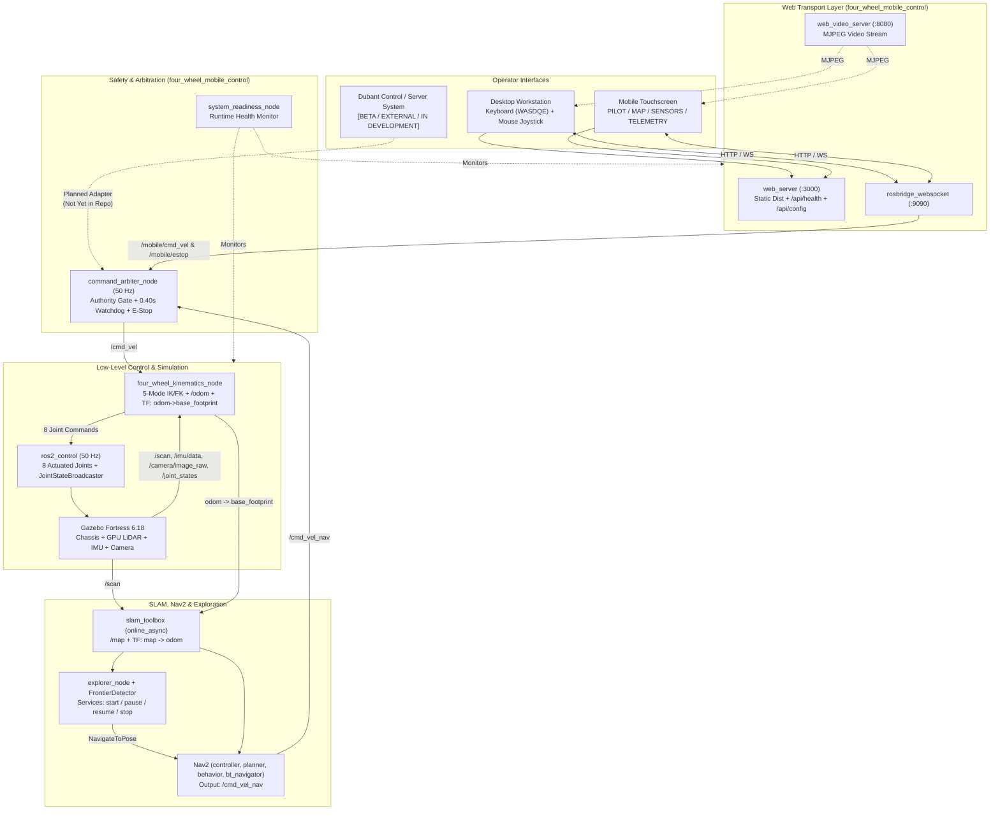

# Four-Wheel Steering Autonomous Mobile Robot (4WS / 4WD)

An actively developed **Four-Wheel Steering and Four-Wheel Drive (`4WS/4WD`)** autonomous mobile robotics platform built on **ROS 2 Humble** and **Ignition Gazebo Fortress**, combining an 8-DOF steering/drive simulation, five-mode planar kinematics and odometry, SLAM Toolbox mapping, Nav2 navigation, frontier exploration, centralized safety command arbitration, and a retro pixel-art Desktop + Mobile web ground-control interface.

---

## Development Status

Project 04 is an actively developed four-wheel steering autonomous mobile robotics platform built using ROS 2 Humble and Gazebo Fortress. The current development version provides a usable simulation and robot-control environment with manual desktop/mobile operation, five steering kinematics modes, sensor visualization, SLAM mapping, autonomous navigation, frontier exploration, and safety command arbitration where implemented and tested. Additional functionality, integration improvements, and external server control integration are ongoing.

| Repository Metric | Current Status |
| :--- | :--- |
| **Development Status** | Active Development |
| **Availability** | Usable in simulation for currently implemented and tested workflows |
| **Overall Stability** | Development / Beta |
| **Testing** | Ongoing (offline unit/static suites and live browser + simulation checks) |
| **Contributions** | Welcome, subject to the [Contribution Guidelines](#contribution-guidelines) |

### Subsystem Maturity Matrix

| Subsystem | Status | Notes |
| :--- | :--- | :--- |
| 8-DOF Robot URDF/Xacro & Gazebo Fortress Simulation | `TESTED` | Verified URDF geometry, 8 joints, `ros2_control` (9 controllers), sensor bridges |
| 5-Mode 4WS/4WD Kinematics & Least-Squares Odometry | `TESTED` | Verified across unit tests and live Gazebo locomotion |
| Command Arbiter, Monotonic Watchdog & E-Stop Latch | `TESTED` | Verified in unit tests (`test_mobile_control_suite.py`) and live UI E2E |
| Pixel-Art Desktop + Mobile Control UI & Keyboard Input | `TESTED` | Verified in headless Chrome CDP across 9 viewports against live ROS 2 simulation |
| SLAM Toolbox (`online_async`) & Nav2 (`DWB` / `Navfn`) | `TESTED` | Verified live map building and path planning/goal cancellation |
| Frontier-Based Autonomous Exploration | `TESTED` | Unit tested and live-tested for goal lifecycle (`start`/`pause`/`resume`/`stop`) |
| AMCL Map Localization Launch (`localization.launch.py`) | `IMPLEMENTED` / `NOT VERIFIED` | Launch file parses cleanly; not run in recent automated CI pass |
| External **Dubant** Control/Server Integration | `IN DEVELOPMENT` / `PLANNED` | External **BETA** server control integration; not yet committed in this repo |

---

## Beta Integration Notice

> [!WARNING]
> **DUBANT BETA SYSTEM NOTICE:** Project 04 currently uses a beta version of the **Dubant** control/server system. This integration is under active development and testing. Features, interfaces, APIs, and operational behaviour may change. It should not be considered a production-ready remote robotics control platform.
>
> All web teleoperation currently executed in this repository runs over the local LAN HTTP / `rosbridge_websocket` / `web_video_server` stack. See [`docs/dubant_beta_integration.md`](docs/dubant_beta_integration.md) for architectural boundaries and integration status.

---

## Project Screenshots

| Desktop Ground-Control Station (`1440x900`) | Mobile Pilot Interface (`412x915`, Right-Handed) | Left-Handed Mobile Layout (`412x915`) |
| :---: | :---: | :---: |
|  |  |  |

| Gazebo Fortress Robot Spawn | RViz2 Live Sensors & TF Tree | Five Steering Geometries |
| :---: | :---: | :---: |
|  |  |  |

| SLAM Toolbox Occupancy Grid | Nav2 Autonomous Path Planning | Frontier Exploration Goals |
| :---: | :---: | :---: |
|  |  |  |

For additional views including PyBullet steering geometry renders and tablet layout captures, see [`docs/visual_documentation.md`](docs/visual_documentation.md).

---

## Overview

Conventional differential-drive or skid-steer robots cannot translate sideways or execute tight, low-slip omnidirectional maneuvers without scrubbing tires. Project 04 implements an **8-actuated-joint** four-wheel steering chassis (`4` independent steering knuckles + `4` independent driven wheels) controlled through `ros2_control` and supervised by a deterministic command multiplexer (`command_arbiter_node`).

A single readiness-gated ROS 2 launch orchestrates Gazebo physics, sensor bridges, wheel kinematics, SLAM Toolbox, Nav2, frontier exploration, and a responsive web ground-control interface usable from both desktop workstations (mouse joystick + physical keyboard) and one-handed mobile touchscreens over Wi-Fi.

---

## Key Features

- **Four-Wheel Steering and Independent Four-Wheel Drive (`TESTED`):** Controls 4 revolute steering joints (`fl/fr/rl/rr_steering_joint`) via `JointGroupPositionController` and 4 continuous wheel joints (`fl/fr/rl/rr_wheel_joint`) via `JointGroupVelocityController` at `50 Hz`.
- **Five Locomotion & Steering Modes (`TESTED`):** Dynamically switches between Front Ackermann (Mode A), 4WS Counter-Phase (Mode B), Crab Steering (Mode C), Generalized Swerve/Holonomic (Mode D), and Rotation-In-Place (Mode E), with angle folding into $[-\pi/2, +\pi/2]$ and wheel spin inversion.
- **Closed-Form Least-Squares Odometry (`TESTED`):** Computes chassis $(v_x, v_y, \omega_z)$ via pseudo-inverse velocity Jacobian across all 4 measured knuckle angles and 4 wheel angular velocities, broadcasting `/odom` and `odom -> base_footprint`.
- **Dual Desktop Manual Control (`TESTED`):** Supports mouse virtual joystick dragging and simultaneous `W/A/S/D/Q/E` keyboard combos plus `Space` immediate stop, synchronized through a single `manualInputPipeline` at `10 Hz`.
- **One-Handed Mobile Touchscreen Dashboard (`TESTED`):** Dedicated mobile layout (`< 1024 px`) featuring `PILOT`, `MAP`, `SENSORS`, and `TELEMETRY` tabs, configurable Right-Handed / Left-Handed joystick mirroring, and persistent E-Stop access.
- **Sensor Perception & Live Streaming (`TESTED`):** Bridges 360-degree GPU LiDAR (`720` beams, `20 m` range), 6-DoF IMU (`50 Hz`), and RGB Camera (`640x480` MJPEG stream via `web_video_server`).
- **Online SLAM Mapping & Nav2 Navigation (`TESTED`):** Integrates `slam_toolbox` (`0.05 m` occupancy resolution) with Nav2 (`DWBLocalPlanner` holonomic limits + `NavfnPlanner`), supporting click/tap-to-goal dispatch (`/goal_pose`) and abort (`/navigate_to_pose/_action/cancel_goal`).
- **Frontier-Based Autonomous Exploration (`TESTED`):** Detects 8-connected map frontiers with Euclidean Distance Transform clearance filtering, utility ranking, and temporal goal blacklisting (`start`/`pause`/`resume`/`stop` lifecycle services).
- **Deterministic Safety Arbitration (`TESTED`):** Enforces exclusive `MANUAL`, `AUTONOMOUS_NAV`, `AUTONOMOUS_EXPLORE`, or `ESTOP` authority (`command_arbiter_node`), a `0.40 s` monotonic manual watchdog, a `0.15 s` mode-transition lockout, and active goal/exploration cancellation upon E-Stop.
- **Retro 8-Bit Web Audio Feedback (`IMPLEMENTED` / `TESTED` in Chrome build):** Web Audio API chiptune SFX for mode changes, authority switches, E-Stop events, goal dispatch, and WebSocket connection state with persistent mute toggle.

---

## Technology Stack

| Layer | Technology / Package | Version / Role in Project 04 |
| :--- | :--- | :--- |
| Operating System | Ubuntu Linux | `22.04.5 LTS` (Jammy) |
| Robotics Middleware | ROS 2 Humble Hawksbill | Core communication, launch orchestration, TF2, lifecycle nodes |
| Physics Simulation | Ignition Gazebo Fortress | `6.18.x`, DART physics engine, SDF worlds, GPU sensors (`ros_gz_sim`, `ros_gz_bridge`) |
| Robot Modeling | URDF / Xacro | Modular `chassis`, `steering`, `wheel`, `sensors`, and `ros2_control` macros |
| Actuator Control | `ros2_control` + `ign_ros2_control` | `joint_state_broadcaster`, 4 position steering + 4 velocity wheel controllers (`50 Hz`) |
| Core Robotics Nodes | Python 3, `rclpy`, `numpy`, `scipy` | Kinematics, least-squares odometry, frontier detection, command arbiter, web server, readiness |
| Mapping & Navigation | SLAM Toolbox & Nav2 | `online_async` mapping, `NavfnPlanner`, `DWBLocalPlanner`, `bt_navigator` |
| Web Transport | `rosbridge_suite` & `web_video_server` | WebSocket JSON topics/services (`:9090`), MJPEG camera stream (`:8080`) |
| Frontend UI | React `18.3`, TypeScript `5.5`, Vite `5.4`, Tailwind CSS `3.4`, `roslib` `1.4` | Responsive desktop/mobile UI, Lucide icons, custom pixel SVGs, Web Audio SFX |

Note: Project 04 ROS 2 nodes and scripts are implemented in **Python 3** and **TypeScript/React**; no custom C++ ROS nodes are authored inside `src/` (C++ plugins come from upstream `ign_ros2_control`, `Nav2`, `rosbridge`, and `SLAM Toolbox` binaries).

---

## System Architecture



---

## Repository Structure

```text
04_four_wheel_steering/
├── README.md                         # Main project overview and quickstart guide
├── .gitignore                        # Excludes colcon builds, node_modules, frontend/dist, reports, secrets
├── .env.example                      # Non-secret environment variable template (incl. Dubant beta placeholders)
├── config/                           # Root controller and RViz config snapshots
├── launch/                           # Standalone URDF display launch file
├── urdf/                             # Exported robot URDF reference
├── worlds/                           # Standalone SDF simulation worlds
├── maps/                             # Saved occupancy grids (.pgm, .yaml, .png)
├── docs/                             # Technical architecture, Dubant beta, and setup guides
├── scripts/                          # Map export, render generation, and capture scripts
├── screenshots/                      # Curated visual verification captures
├── tests/                            # Offline unit/static suites and live Gazebo E2E suites
└── src/
    ├── four_wheel_description/       # URDF/Xacro model, SDF worlds, Gazebo spawn & sensor bridges
    ├── four_wheel_control/           # 5-mode IK/FK solver, kinematics/odometry node, keyboard teleop
    ├── four_wheel_navigation/        # SLAM Toolbox, Nav2, and AMCL configs & launches
    ├── four_wheel_exploration/       # EDT frontier detector and exploration lifecycle node
    └── four_wheel_mobile_control/    # Master launch, launch_gate, arbiter, readiness, web server, frontend
        └── frontend/                 # React + TypeScript + Vite ground-control application
```

---

## Installation

### Prerequisites

- **OS:** Ubuntu `22.04 LTS`
- **ROS 2:** ROS 2 Humble Desktop + Gazebo Fortress (`ros_gz_sim`, `ros_gz_bridge`, `ign_ros2_control`)
- **ROS Packages:** `ros-humble-ros2-control`, `ros-humble-ros2-controllers`, `ros-humble-slam-toolbox`, `ros-humble-navigation2`, `ros-humble-nav2-bringup`, `ros-humble-rosbridge-server`, `ros-humble-web-video-server`, `ros-humble-twist-mux`, `ros-humble-xacro`
- **Python Libraries:** `python3-numpy`, `python3-scipy`, `python3-pytest`, `python3-yaml`
- **Node.js / npm:** Node.js LTS (`>= 18.x` recommended) and `npm`

```bash
sudo apt update
sudo apt install -y \
  ros-humble-ros2-control \
  ros-humble-ros2-controllers \
  ros-humble-ign-ros2-control \
  ros-humble-ros-gz-sim \
  ros-humble-ros-gz-bridge \
  ros-humble-slam-toolbox \
  ros-humble-navigation2 \
  ros-humble-nav2-bringup \
  ros-humble-rosbridge-server \
  ros-humble-web-video-server \
  ros-humble-twist-mux \
  ros-humble-xacro \
  python3-numpy \
  python3-scipy \
  python3-pytest \
  python3-yaml
```

If an external overlay provides `ros_gz` or `web_video_server` outside `/opt/ros/humble`, source that overlay after `/opt/ros/humble/setup.bash`.

---

## Build Instructions

Always run ROS 2 Humble commands with `/usr/bin/python3` cleanly isolated from Conda/local-site Python overrides via `PYTHONNOUSERSITE=1`:

1. **Install frontend dependencies and build the Vite bundle** (`four_wheel_mobile_control/setup.py` packages `frontend/dist/` during `colcon build`):

   ```bash
   cd src/four_wheel_mobile_control/frontend
   npm ci
   npm run build
   cd ../../..
   ```

2. **Build the ROS 2 workspace:**

   ```bash
   export PYTHONNOUSERSITE=1
   source /opt/ros/humble/setup.bash
   colcon build
   source install/setup.bash
   ```

To rebuild only `four_wheel_mobile_control` after frontend edits:

```bash
colcon build --packages-select four_wheel_mobile_control
source install/setup.bash
```

---

## Launch Instructions

Start the entire system with one readiness-gated master launch command:

```bash
export PYTHONNOUSERSITE=1
source /opt/ros/humble/setup.bash
source install/setup.bash
ros2 launch four_wheel_mobile_control complete_mobile_simulation.launch.py
```

The master launch executes sequential gated stages (`launch_gate --stage sim|slam|nav2`) and prints `PROJECT 04 SYSTEM READY` along with detected LAN URLs when all subsystems pass health checks.

### Master Launch Arguments

| Argument | Default | Purpose |
| :--- | :--- | :--- |
| `world` | `outdoor_proving_ground.sdf` | Gazebo Fortress SDF world path (validated before startup) |
| `headless` | `false` | Run Gazebo server without GUI (`-s -r`) |
| `use_rviz` | `true` | Launch RViz2 (skipped when `headless:=true`) |
| `use_slam` | `true` | Start `slam_toolbox` online async mapping |
| `use_navigation` | `true` | Start Nav2 servers (`planner`, `controller`, `behavior`, `bt_navigator`) |
| `use_exploration` | `true` | Start `explorer_node` |
| `use_mobile_control` | `true` | Start `command_arbiter_node`, `rosbridge`, `web_video_server`, `web_server`, `system_readiness_node` |
| `use_camera` | `true` | Enable RGB camera Gazebo bridge and MJPEG streaming |
| `camera_width` / `camera_height` | `640` / `480` | Camera image resolution (px) |
| `use_sim_time` | `true` | Synchronize nodes to `/clock` |
| `exploration_autostart` | `false` | Automatically start frontier exploration at boot |
| `web_port` / `rosbridge_port` / `video_port` | `3000` / `9090` / `8080` | Network ports for dashboard, rosbridge, and camera server |

Headless simulation example:

```bash
ros2 launch four_wheel_mobile_control complete_mobile_simulation.launch.py headless:=true use_rviz:=false
```

---

## Desktop Controls

Open `http://localhost:3000` on the host workstation once ready.

- **Mouse Virtual Joystick:** Drag anywhere inside the circular pixel pad (`MANUAL` authority active) to command planar velocity $(v_x, v_y)$; use **CCW** and **CW** buttons for yaw rotation $\omega_z$. Releasing the pointer immediately sends zero velocity.
- **Physical Keyboard Control:** Controlled via `manualInputPipeline.ts` sharing `/mobile/cmd_vel` with the joystick (`ON/OFF` toggle and `25%-100%` sensitivity slider in the Settings modal).

| Key | Action | Published Velocity Component |
| :--- | :--- | :--- |
| `W` / `S` | Forward / Reverse | $+v_x$ / $-v_x$ |
| `A` / `D` | Lateral Left / Right (Crab/Swerve) | $+v_y$ / $-v_y$ |
| `W+A`, `W+D`, `S+A`, `S+D` | Diagonal planar translation | Vector-normalized $(v_x, v_y)$ |
| `Q` / `E` | Rotate Counter-Clockwise / Clockwise | $+\omega_z$ / $-\omega_z$ |
| `Space` | Immediate Stop | Zeroes all active keyboard/manual velocities immediately |

**Keyboard Safety Locks:** Keyboard motion is suppressed and cleared to zero on E-Stop, authority switch away from `MANUAL`, WebSocket disconnect, window `blur`, tab `visibilitychange`, focus inside editable inputs (`input`/`textarea`/`select`), or when toggled `OFF`.

Optional terminal teleoperation node:

```bash
ros2 run four_wheel_control teleop_keyboard
```

---

## Mobile Controls

1. Connect the phone or tablet and the ROS workstation to the **same Wi-Fi LAN** (with AP/client isolation disabled).
2. Read the host LAN IP printed in the launch terminal or query `hostname -I`.
3. Open `http://<ROBOT_IP>:3000` in Chrome or Safari. If using custom ports, adjust host/ports in the dashboard **Settings** modal.
4. Ensure local firewall rules permit TCP ports `3000`, `8080`, and `9090` on the private LAN subnet only (see [`docs/mobile_network_setup.md`](docs/mobile_network_setup.md)).

### Mobile Dashboard Layout

- **Sticky E-Stop Banner:** Remains accessible at the top across all four mobile tabs (`PILOT`, `MAP`, `SENSORS`, `TELEMETRY`).
- **One-Handed Operation:** Configure **Right-Handed** or **Left-Handed** mode in Settings to mirror the joystick/`CCW`/`CW` controls and Top-Down Robot View horizontally under your preferred thumb.
- **Dead-Man & Watchdog Behaviour:** Lifting your thumb or losing Wi-Fi stops manual motion within the `0.40 s` monotonic watchdog timeout.

---

## Robot Steering Modes

The four-wheel geometry (`wheelbase = 0.36 m`, `track_width = 0.36 m`, `wheel_radius = 0.08 m`) supports five operator-selectable modes over `/four_wheel/set_mode`:

| Mode | Identifier | Mechanical / Kinematic Action |
| :--- | :--- | :--- |
| **A. Ackermann** | `front_steer` | Front knuckles compute inner/outer Ackermann curve angles; rear knuckles locked straight (`0 rad`) |
| **B. 4WS Counter-Phase** | `four_wheel_steer` | Front and rear knuckles steer equally in opposite directions to tighten turning radius |
| **C. Crab Steer** | `crab` | All four wheels align parallel at $\operatorname{atan2}(v_y, v_x)$ for pure diagonal/lateral translation |
| **D. Generalized Swerve** | `generalized` | Solves $v_x - \omega_z y_i$ and $v_y + \omega_z x_i$ at each corner independently for full 3-DoF holonomic motion |
| **E. Rotation-In-Place** | `in_place_spin` | Positions wheels tangentially around the robot center ($\pm 45^\circ$) for zero-radius rotation |

---

## Sensors and Telemetry

- **LiDAR (`/scan`):** 360-degree GPU laser scanner (`720` samples, `0.10-20.0 m`, `15 Hz` Gazebo update rate), rendered in RViz2 and in the dashboard `LiDAR (360°)` polar radar.
- **IMU (`/imu/data`):** `50 Hz` orientation, angular velocity, and linear acceleration feed (`sensor_msgs/Imu`), visualized in the dashboard `IMU` panel.
- **RGB Camera (`/camera/image_raw`, `/camera/camera_info`):** `15 Hz` camera feed (`640x480` default), streamed over HTTP MJPEG (`web_video_server :8080`) with play/pause stream control.
- **Odometry & Readiness Telemetry:** `/odom`, `/joint_states`, `/mobile/arbiter_status`, `/exploration/coverage`, `/exploration/status`, and `/system/readiness_status`.

---

## SLAM and Autonomous Navigation

- **Mapping:** `slam_toolbox` (`online_async`) consumes `/scan` and `/odom` to maintain `map -> odom` transforms and publish `/map` at `0.05 m` resolution.
- **Autonomous Navigation:** Selecting `NAV2` authority lets operators click/tap any free-space cell on the interactive SLAM occupancy grid in the dashboard and dispatch a `PoseStamped` target on `/goal_pose`. Active navigation trajectories can be canceled via the dashboard abort button (`/navigate_to_pose/_action/cancel_goal`).
- **Nav2 Integration:** `controller_server` (`dwb_core::DWBLocalPlanner`, `20 Hz`) emits velocity commands to `/cmd_vel_nav` rather than directly driving motors, keeping `command_arbiter_node` in control of safety switching.

---

## Exploration

`four_wheel_exploration` pairs `FrontierDetector` (8-connected frontier extraction, connected-component clustering, and Euclidean Distance Transform obstacle clearance) with `explorer_node` (`IDLE` -> `SEARCHING` -> `NAVIGATING` -> `PAUSED` / `COMPLETED`).

Operators trigger **START**, **PAUSE**, **RESUME**, and **STOP** from the Navigation & Exploration panel (`EXPLORE` authority) or via ROS 2 `Trigger` services (`/exploration/start`, `/exploration/pause`, `/exploration/resume`, `/exploration/stop`).

---

## Safety Mechanisms

`command_arbiter_node` (`50 Hz`) guarantees that no conflicting velocity sources or runaway states reach the wheels:

1. **Single-Authority Gate:** Only the currently authorized source (`MANUAL` -> `/mobile/cmd_vel`, `AUTONOMOUS_NAV` / `AUTONOMOUS_EXPLORE` -> `/cmd_vel_nav`, `ESTOP` -> zero) can write `/cmd_vel`.
2. **Latched Emergency Stop (`ESTOP`):** Engaging **EMERGENCY STOP** latches `estop_active = true`, publishes zero velocity, cancels active `navigate_to_pose` goals, pauses `explorer_node`, and blocks motion until **RESET E-STOP** is explicitly pressed (re-arming into safe idle `MANUAL` mode).
3. **Monotonic Dead-Man Watchdog (`0.40 s`):** Uses `time.monotonic()` (immune to paused Gazebo `/clock`) to zero velocity if `/mobile/cmd_vel` or `/mobile/heartbeat` stops updating.
4. **Mode-Transition Lockout (`0.15 s`):** Enforces a brief zero-velocity hold across every operating-mode transition.

---

## Dubant Beta Integration

Project 04 incorporates external testing and coordination with the **Dubant control/server system (BETA)**.

- **Current Scope:** Dubant is an external server-based control system under active beta development; its runtime binaries, private endpoints, and adapter SDK are **not** included in this repository snapshot.
- **Verified Boundary:** Local simulation, desktop/mobile dashboard serving, `rosbridge` WebSocket messaging, and `command_arbiter_node` safety multiplexing work standalone on a workstation/LAN without requiring a Dubant server connection.
- **Not Yet Verified:** Remote WAN control, server-issued authentication tokens, and cloud-mediated telemetry through Dubant remain `IN DEVELOPMENT` / `NOT VERIFIED`.

Full details, boundary diagram, risks, and roadmap appear in [`docs/dubant_beta_integration.md`](docs/dubant_beta_integration.md).

---

## Testing and Validation

### 1. Verified After Final Code & Documentation Changes (`TESTED`)

- **Frontend Production Build:** `cd src/four_wheel_mobile_control/frontend && npm run build` (`tsc && vite build`, `0` errors).
- **ROS 2 Package Build (`four_wheel_mobile_control`):** `colcon build --packages-select four_wheel_mobile_control` (exit code `0`) followed by full workspace `colcon build` verification before push.
- **Offline Static & Unit Pytest Suite (`34` tests):**
  ```bash
  export PYTHONNOUSERSITE=1
  source /opt/ros/humble/setup.bash
  source install/setup.bash
  /usr/bin/python3 -m pytest -v \
    tests/test_static_checks.py \
    tests/test_kinematics.py \
    tests/test_urdf.py \
    tests/test_exploration.py \
    tests/test_mobile_control_suite.py
  ```
- **Live Headless Chrome CDP + Gazebo Simulation UI E2E Check:** Validated against running `complete_mobile_simulation.launch.py` across 9 viewports (`1920x1080` down to `360x800`), physical keyboard `W/A/S/D/Q/E/Space` + diagonal combos + blur + `ON/OFF` toggle + `NAV2` lock + WebSocket disconnect/reconnect, mouse & mobile joysticks, E-Stop latch/reset, Left-Handed mirroring, and all 4 mobile tabs with `0` uncaught JS console errors.

### 2. Full-Stack Live Gazebo & Nav2 Scripts (Run Manually Against Running Simulation)

Requires an active headless or GUI Gazebo simulation (`complete_mobile_simulation.launch.py`):

```bash
/usr/bin/python3 tests/test_master_launch_e2e.py
/usr/bin/python3 tests/test_control_simulation.py
/usr/bin/python3 tests/test_slam_navigation.py
```

Note: Live physical smartphone hardware tests over external Wi-Fi and live Dubant beta server tests are not part of automated CI and require manual verification.

---

## Known Limitations

- **Beta System Maturity:** Both Project 04 and the companion Dubant server control system are under active development; APIs and parameters may evolve.
- **Odometry Source:** `/odom` is integrated purely from wheel/steering kinematics without EKF sensor fusion against `/imu/data`, so high wheel slip on uneven terrain is not directly compensated.
- **Local Transport Security:** Local `rosbridge_websocket` (`:9090`) and `web_server` (`:3000`) use plaintext HTTP/WS on the private LAN without built-in authentication; do not expose ports directly to public networks without an authenticating TLS reverse proxy.
- **Standalone Hardware Deployment:** Physics, collision boxes, and controller interfaces target Ignition Gazebo Fortress (`ign_ros2_control`); real-robot motor drivers and hardware E-Stop relays are not included.
- **AMCL Localization Script:** `four_wheel_navigation/launch/localization.launch.py` is implemented and statically checked but requires manual runtime verification with a saved map.

---

## Development Roadmap

- Complete and freeze the **Dubant** server adapter API, TLS transport, token authentication, and latency budget compatibility with the watchdog.
- Add `robot_localization` EKF node fusing wheel kinematic odometry (`/odom`) and IMU (`/imu/data`).
- Support automated `colcon test` execution of `test_master_launch_e2e.py` in CI headless containers.
- Extend physical hardware interface documentation once rover hardware drivers are integrated.

---

## Technical Documentation

| Document | Focus |
| :--- | :--- |
| [`docs/system_architecture.md`](docs/system_architecture.md) | End-to-end ROS 2, Gazebo, Nav2, and Web architecture |
| [`docs/complete_system_launch_guide.md`](docs/complete_system_launch_guide.md) | Staged startup, launch arguments, and clean shutdown |
| [`docs/robot_architecture.md`](docs/robot_architecture.md) | URDF/Xacro hierarchy, joint frames, inertias, and sensors |
| [`docs/steering_kinematics.md`](docs/steering_kinematics.md) | Mathematical derivations for Modes A-E and least-squares FK |
| [`docs/ros2_control_architecture.md`](docs/ros2_control_architecture.md) | `ign_ros2_control` and 9-controller architecture |
| [`docs/simulation_guide.md`](docs/simulation_guide.md) | Ignition Gazebo Fortress worlds and physics parameters |
| [`docs/navigation_guide.md`](docs/navigation_guide.md) | SLAM Toolbox, Nav2 DWB/Navfn, and frontier exploration |
| [`docs/mobile_control_architecture.md`](docs/mobile_control_architecture.md) | Web control stack architecture and ROS topic interfaces |
| [`docs/mobile_dashboard_guide.md`](docs/mobile_dashboard_guide.md) | Desktop and mobile operator manual |
| [`docs/mobile_network_setup.md`](docs/mobile_network_setup.md) | LAN connectivity, firewall rules, and multi-device access |
| [`docs/rosbridge_setup.md`](docs/rosbridge_setup.md) | `rosbridge_suite` and `web_video_server` settings |
| [`docs/safety_and_command_arbitration.md`](docs/safety_and_command_arbitration.md) | Authority state machine, E-Stop, and watchdog timing |
| [`docs/dubant_beta_integration.md`](docs/dubant_beta_integration.md) | Dubant beta server status, boundaries, risks, and roadmap |
| [`docs/integration_testing.md`](docs/integration_testing.md) | Layered static, unit, and live simulation test procedures |
| [`docs/system_troubleshooting.md`](docs/system_troubleshooting.md) | Common launch, Python/ROS env, and connectivity fixes |
| [`docs/visual_documentation.md`](docs/visual_documentation.md) | Curated screenshot gallery |
| [`docs/repository_audit.md`](docs/repository_audit.md) | Pre-publication repository audit and hygiene summary |

Package-level documentation: [`four_wheel_description`](src/four_wheel_description/README.md), [`four_wheel_control`](src/four_wheel_control/README.md), [`four_wheel_navigation`](src/four_wheel_navigation/README.md), [`four_wheel_exploration`](src/four_wheel_exploration/README.md), [`four_wheel_mobile_control`](src/four_wheel_mobile_control/README.md).

---

## Contribution Guidelines

Contributions, bug reports, and pull requests are welcome:

1. Fork the repository and create a dedicated feature branch from `main`.
2. Keep frontend bundles (`frontend/dist/`), `build/`, `install/`, `log/`, `.env`, and internal notes out of commits.
3. Run both `npm run build` (inside `src/four_wheel_mobile_control/frontend`) and the offline `pytest` verification suite (`tests/test_static_checks.py`, `tests/test_kinematics.py`, `tests/test_urdf.py`, `tests/test_exploration.py`, `tests/test_mobile_control_suite.py`) before opening a pull request.
4. Clearly mark unverified hardware or simulation behaviour rather than assuming untested setups pass.

---

## Author and Contact

**Doresh Kumawat**  
Email: [dkworks108@gmail.com](mailto:dkworks108@gmail.com)

**Focus Areas:**

- Robotics and Autonomous Systems
- ROS 2 and Robot Simulation
- Robot Control and Kinematics
- Autonomous Navigation and SLAM
- Artificial Intelligence and Software Engineering

Project 04 focuses on developing robotics systems that combine mechanical design, robot simulation, control software, autonomous navigation, and human-machine interfaces.

---

## License Information

This repository currently does **not** include a root `LICENSE` file and therefore has **no declared repository-wide open-source license** at this stage of development. Individual ROS 2 package manifests inside `src/*/package.xml` contain `Apache-2.0` metadata fields; contact the author ([dkworks108@gmail.com](mailto:dkworks108@gmail.com)) prior to redistribution or commercial use until a formal repository license is added.
