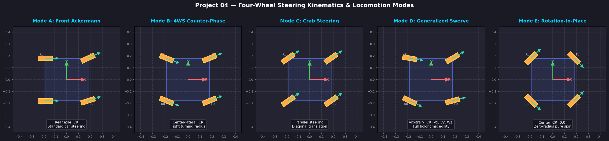
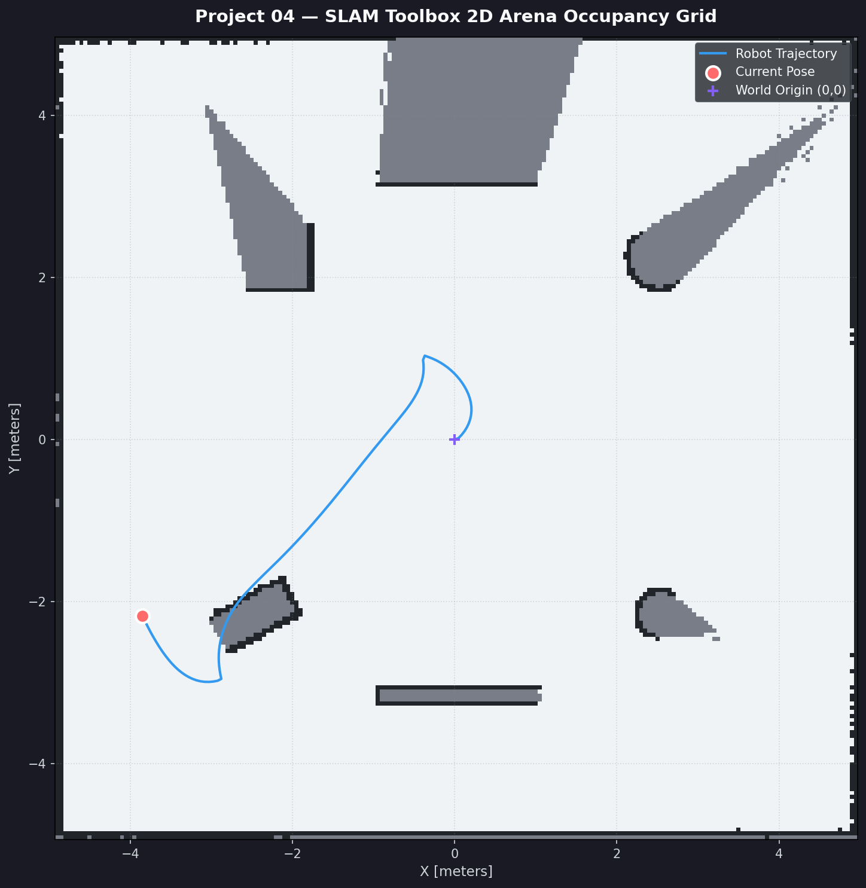
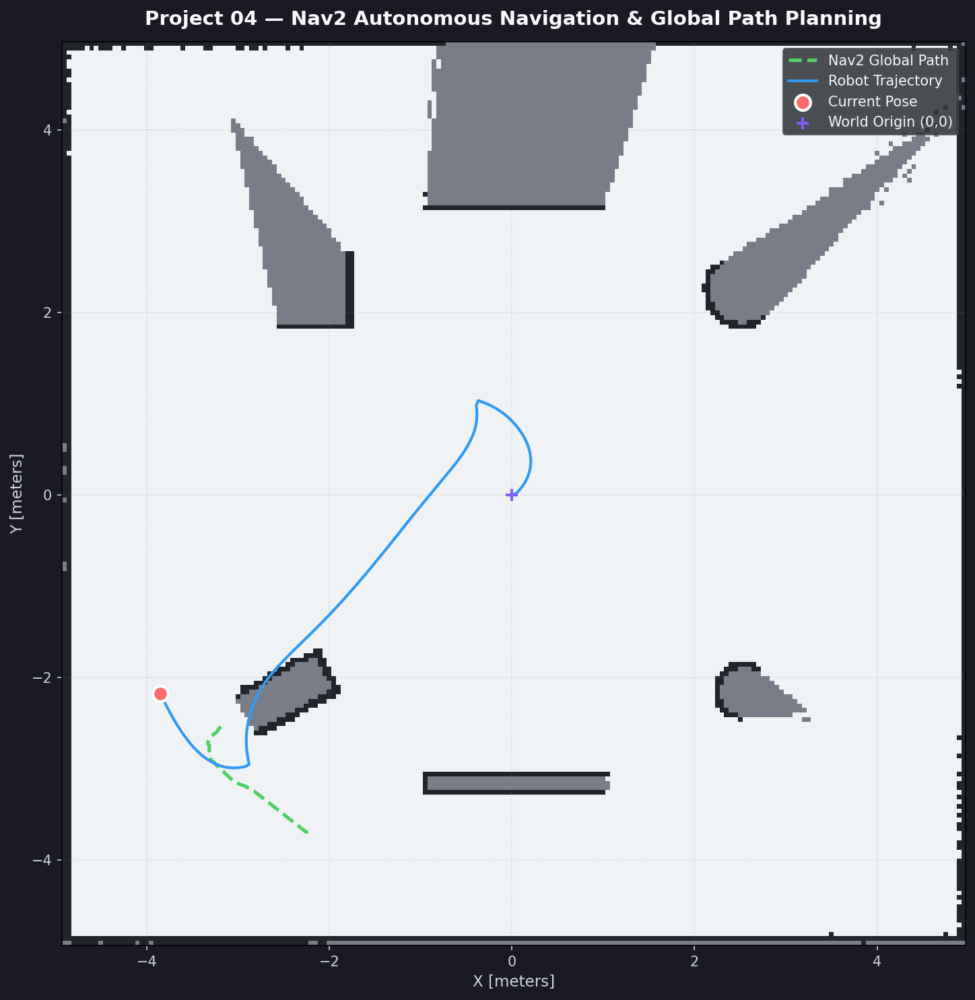
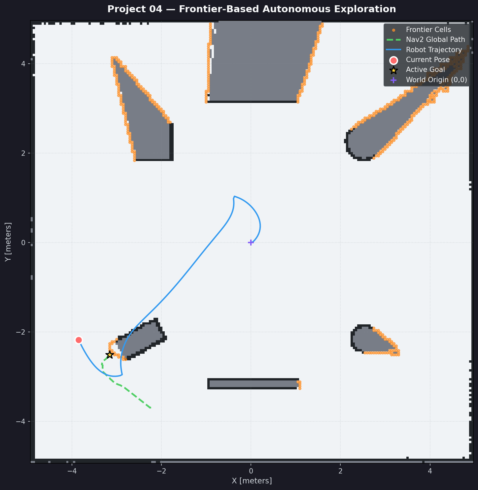

# Project 04: Four-Wheel Steering Autonomous Mobile Robot (4WS / 4WD)

[](https://docs.ros.org/en/humble/)
[](https://gazebosim.org/)
[](https://control.ros.org/)
[](https://navigation.ros.org/)
[](https://github.com/SteveMacenski/slam_toolbox)

A production-grade, fully autonomous **Four-Wheel Steering and Four-Wheel Drive (4WS/4WD)** mobile robot simulation built for ROS 2 Humble and Gazebo Fortress.

Featuring **8 independently controlled joints** (4 revolute steering knuckles + 4 continuous traction wheels), an advanced kinematics engine with **5 locomotion modes**, closed-form least-squares planar odometry, 2D GPU LiDAR perception, SLAM Toolbox mapping, Nav2 autonomous navigation, and frontier-based autonomous exploration.

---

## 📸 System Previews

| Technical Steering Modes | SLAM Arena Map |
| :---: | :---: |
|  |  |

| Nav2 Autonomous Path Planning | Frontier-Based Autonomous Exploration |
| :---: | :---: |
|  |  |

---

## 🚀 Key Features

1. **8 Actuated Degrees of Freedom:**
   - 4 Revolute Knuckle Steering Joints (`fl_steering_joint`, `fr_steering_joint`, `rl_steering_joint`, `rr_steering_joint`)
   - 4 Continuous Traction Wheel Joints (`fl_wheel_joint`, `fr_wheel_joint`, `rl_wheel_joint`, `rr_wheel_joint`)
2. **5 Kinematic Locomotion Modes:**
   - **Mode A (Front Ackermann):** Inner/outer wheel geometry with ICR on rear axle.
   - **Mode B (4WS Counter-phase):** Opposite front/rear steering halving turning radius ($R_{min} = 0.42$ m).
   - **Mode C (Crab Steering):** Parallel wheel deflection for pure diagonal translation without heading change.
   - **Mode D (Generalized Swerve):** Full 3-DoF planar holonomic capability ($v_x, v_y, \omega_z$).
   - **Mode E (Rotation-In-Place):** Tangential wheel orientation around vehicle centroid for pure zero-radius spin.
3. **Closed-Form Least-Squares Odometry:** Decoupled pseudo-inverse integration from 4 measured knuckle angles and 4 wheel velocities, publishing `/odom` and TF `odom -> base_footprint` at 50 Hz.
4. **Perception Suite:** 360° GPU LiDAR (720 beams, 10 Hz), 6-DoF IMU (50 Hz), and RGB Camera.
5. **SLAM Toolbox Mapping:** High-fidelity 5 cm online asynchronous occupancy grid generation.
6. **Nav2 Navigation Stack:** DWB local trajectory planner and Navfn global planner configured for 4WS agility.
7. **Frontier-Based Autonomous Exploration:** Connected-component frontier clustering, Euclidean Distance Transform (EDT) obstacle clearance, and temporal spatial blacklisting.

---

## 📂 Repository Structure

```
04_four_wheel_steering/
├── config/
│   └── ros2_controllers.yaml            # ros2_control hardware interface and controllers
├── docs/
│   ├── robot_architecture.md            # URDF, link tree, masses, sensor specs
│   ├── steering_kinematics.md           # Mathematical derivations & odometry formulations
│   ├── ros2_control_architecture.md     # Controller manager and kinematics node
│   ├── simulation_guide.md              # Gazebo Fortress physics & SDF world
│   └── navigation_guide.md              # SLAM, Nav2, and frontier exploration guide
├── maps/
│   ├── four_wheel_arena_map.yaml        # Arena map metadata
│   ├── four_wheel_arena_map.pgm         # Grayscale 2D occupancy grid
│   └── four_wheel_arena_map.png         # Map image preview
├── reports/
│   └── final_project_report.md          # Comprehensive engineering verification report
├── screenshots/                         # Verification artifacts and screenshots
├── scripts/
│   ├── run_exploration_and_capture.py   # Autonomous exploration runner & artifact generator
│   └── export_map_files.py              # Map exporter utility
├── src/
│   ├── four_wheel_description/          # URDF/Xacro, meshes, RViz, and launch files
│   ├── four_wheel_control/              # Kinematics engine, odometry, and teleoperation
│   ├── four_wheel_navigation/           # SLAM Toolbox and Nav2 launch & configurations
│   └── four_wheel_exploration/          # Frontier detector and autonomous explorer node
├── tests/
│   ├── test_urdf.py                     # Automated URDF and inertia validation
│   ├── test_kinematics.py               # Forward & inverse kinematics unit tests
│   ├── test_exploration.py              # Frontier detection & clustering unit tests
│   ├── test_control_simulation.py       # Live Gazebo dynamic simulation tests
│   └── test_slam_navigation.py          # Full-stack SLAM & Nav2 integration tests
└── worlds/
    └── four_wheel_arena.sdf             # Custom 10m x 10m indoor testing arena
```

---

## 🛠️ Build & Installation

### Environment Setup
```bash
export PYTHONNOUSERSITE=1
source /opt/ros/humble/setup.bash
source /media/bumble/DATA_DISK/robotics/opt/ros_extra/setup.bash
```

### Build Workspace
```bash
cd /media/bumble/DATA_DISK/robotics/projects/04_four_wheel_steering
colcon build --symlink-install
source install/setup.bash
```

---

## 🎮 Execution & Usage

### 1. Launch Complete Autonomous Simulation (Gazebo + SLAM + Nav2 + Exploration)
```bash
ros2 launch four_wheel_description complete_simulation.launch.py
```

### 2. Launch Base Simulation with RViz (Manual Control Mode)
```bash
ros2 launch four_wheel_description gazebo.launch.py
```

### 3. Run Interactive Keyboard Teleoperation
In a new terminal:
```bash
ros2 run four_wheel_control teleop_keyboard
```
- `w` / `x`: Linear velocity $v_x$
- `a` / `d`: Yaw velocity $\omega_z$
- `q` / `e`: Lateral velocity $v_y$ (crab translation)
- `1` to `5`: Switch active locomotion mode (Ackermann, 4WS, Crab, Swerve, In-Place)
- `Space`: Emergency stop

### 4. Run SLAM & Nav2 Stack
```bash
# SLAM Toolbox Mapping
ros2 launch four_wheel_navigation slam.launch.py

# Nav2 Autonomous Navigation
ros2 launch four_wheel_navigation navigation.launch.py
```

---

## 🧪 Automated Testing

### Run All Unit Tests
```bash
/usr/bin/python3 -m pytest tests/test_urdf.py tests/test_kinematics.py tests/test_exploration.py -v
```

### Run Live Gazebo Physics & Locomotion Integration Tests
```bash
/usr/bin/python3 tests/test_control_simulation.py
```

### Run Full-Stack SLAM & Nav2 Navigation Integration Tests
```bash
/usr/bin/python3 tests/test_slam_navigation.py
```

---

## 📊 Empirical Verification Summary

- **Unit Tests:** 17/17 Passed (100%)
- **Gazebo Dynamic Tests:** 8/8 Passed (100%)
  - Physics stability drift: $0.0000$ m
  - Mode B forward travel: $0.969$ m
  - Mode C lateral travel: $0.763$ m
  - Mode E in-place rotation: $98.3^\circ$ with $0.000$ m drift
  - Sensor health: 720/720 LiDAR beams, $0$ chassis self-scans, $9.80$ m/s² IMU gravity
- **SLAM & Nav2 Tests:** 5/5 Passed (100%)
  - TF tree completeness: `map -> odom -> base_footprint -> lidar_link`
  - Waypoint navigation: Goal reached & succeeded
  - Map growth during exploration: Initial $6,169 \to 35,069$ cells ($+468.5\%$ expansion)
