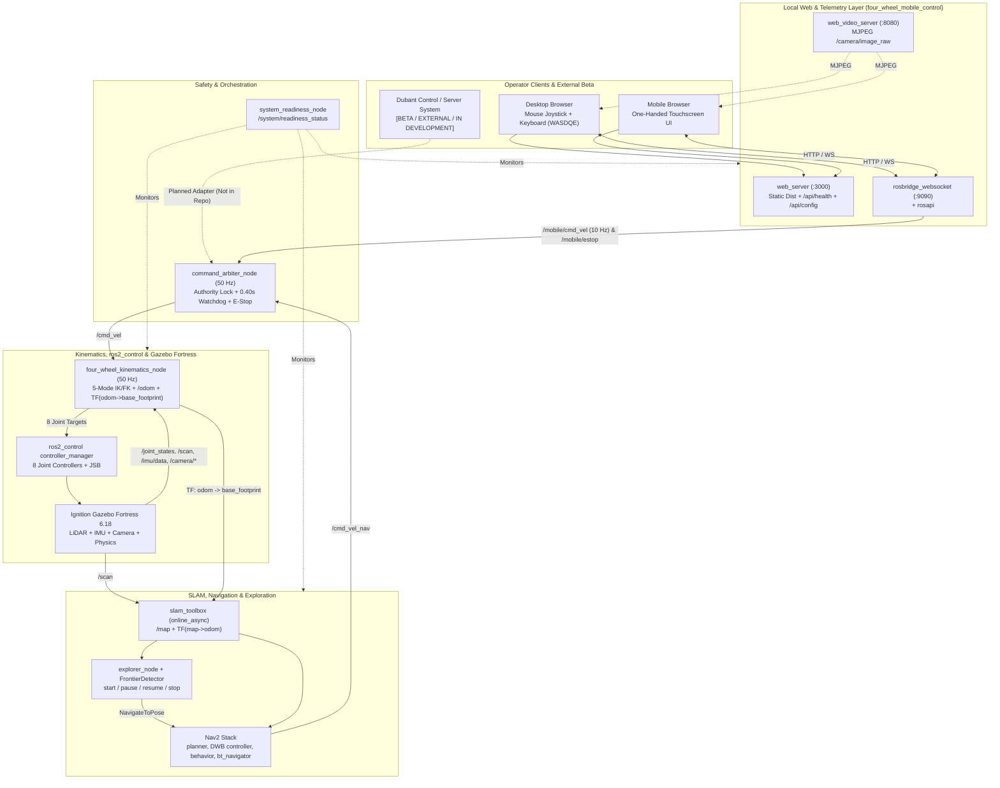

# 4ws_robot — Four-Wheel Steering Autonomous Mobile Robot

[](https://docs.ros.org/en/humble/)
[](https://gazebosim.org/docs/fortress)
[](https://react.dev/)
[](https://www.python.org/)
[](#current-development-status)
[](#license)

**A multi-mode Four-Wheel Steering and Four-Wheel Drive (`4WS/4WD`) robotics platform on ROS 2 Humble and Ignition Gazebo Fortress, uniting 8-DOF actuation, five planar steering modes, SLAM Toolbox, Nav2, frontier exploration, safety command arbitration, and a web ground-control interface.**

> [!WARNING]
> **DUBANT BETA INTEGRATION NOTICE:** `4ws_robot` currently uses a **beta** version of the **Dubant** control/server system. This integration is under active development and testing. Features, interfaces, APIs, and operational behaviour may change. It should not be considered a production-ready remote robotics control platform. All runtime web control currently shipped in this repository operates locally over HTTP (`:3000`), `rosbridge_websocket` (`:9090`), and `web_video_server` (`:8080`). See [`docs/dubant_beta_integration.md`](docs/dubant_beta_integration.md).

---

## Table of Contents

1. [Overview and Motivation](#overview-and-motivation)
2. [Current Development Status](#current-development-status)
3. [Key Features and Limitations](#key-features-and-limitations)
4. [Screenshots and Visual Previews](#screenshots-and-visual-previews)
5. [Technology Stack and Visual Identity](#technology-stack-and-visual-identity)
6. [System Architecture](#system-architecture)
7. [Repository Directory Structure](#repository-directory-structure)
8. [Installation and Setup](#installation-and-setup)
9. [Running and Using 4ws_robot](#running-and-using-4ws_robot)
10. [API and Communication Reference](#api-and-communication-reference)
11. [Dubant Beta Integration](#dubant-beta-integration)
12. [Testing and Quality Assurance](#testing-and-quality-assurance)
13. [Deployment, Networking, and Operational Safety](#deployment-networking-and-operational-safety)
14. [Development, Contribution, and Roadmap](#development-contribution-and-roadmap)
15. [Documentation, Author, and License](#documentation-author-and-license)

---

## Overview and Motivation

### Problem Statement & Objectives

Standard differential-drive and skid-steer ground robots cannot translate laterally without rotating first, and sharp turns induce wheel scrub and localization drift. **`4ws_robot`** (`dkworks108/4ws_robot`, maintained locally in directory `04_four_wheel_steering`) addresses constrained indoor and arena maneuverability by giving each corner independent steering and traction drive.

Primary engineering objectives:

- Simulate an **8-actuated-joint** `4WS/4WD` chassis in Gazebo Fortress via `ros2_control` (`50 Hz`).
- Provide unified inverse and forward kinematics across five selectable steering geometries alongside closed-form least-squares odometry.
- Combine SLAM mapping, Nav2 autonomous path execution, and automated frontier exploration under a single safety command arbiter.
- Expose responsive, low-friction Desktop (mouse + physical keyboard) and Mobile (one-handed Left/Right-Handed touchscreen) controls via a single launch command.

### Project Scope

`4ws_robot` targets ROS 2 Humble simulation and local-network web teleoperation workflows. Physical hardware drivers, hardware E-Stop relays, EKF IMU-odom fusion, and external WAN **Dubant** server adapters are outside the verified scope of the current source snapshot.

---

## Current Development Status

`4ws_robot` is an actively developed four-wheel steering autonomous mobile robotics platform built using ROS 2 Humble and Gazebo Fortress. The current development version provides a usable simulation and robot-control environment with manual desktop/mobile operation, five steering kinematics modes, sensor visualization, SLAM mapping, autonomous navigation, frontier exploration, and safety command arbitration where implemented and tested. Additional functionality, integration improvements, and external server control integration are ongoing.

| Attribute | Value |
| :--- | :--- |
| **Development Status** | Active Development |
| **Availability** | Usable in simulation and local LAN web control for supported workflows |
| **Overall Stability** | Development / Beta |
| **Testing** | Ongoing (unit, static, live simulation, and browser E2E validation) |
| **Contributions** | Welcome under [Development, Contribution, and Roadmap](#development-contribution-and-roadmap) |

### Subsystem Verification Status

| Subsystem | Status | Notes |
| :--- | :--- | :--- |
| URDF/Xacro Model & Gazebo Fortress Physics | `TESTED` | Verified URDF parsing, 8 joints, 9 active controllers, sensor bridges |
| 5-Mode 4WS/4WD Kinematics & Odometry | `TESTED` | Inverse/forward kinematics verified via `pytest` (`test_kinematics.py`) and Gazebo runs |
| Command Arbiter, Watchdog & E-Stop | `TESTED` | Verified via offline suite (`test_mobile_control_suite.py`) and live browser tests |
| Desktop & Mobile Pixel-Art Web UI | `TESTED` | Verified in headless Chrome CDP across 9 viewports against live ROS 2 simulation |
| SLAM Toolbox (`online_async`) & Nav2 (`DWB`) | `TESTED` | Verified map generation, `/goal_pose` dispatch, and goal cancellation |
| Frontier-Based Autonomous Exploration | `TESTED` | Verified frontier clustering (`test_exploration.py`) and lifecycle services |
| AMCL Saved-Map Localization (`localization.launch.py`) | `IMPLEMENTED` / `NOT VERIFIED` | Launch configuration exists; not run in recent automated passes |
| External **Dubant** Control/Server System | `IN DEVELOPMENT` / `NOT VERIFIED` | External **BETA** service; no Dubant adapter source committed in this repository |
| Multi-Sensor EKF (`robot_localization`) | `PLANNED` | `/odom` relies purely on kinematic joint integration |

---

## Key Features and Limitations

### Implemented and Tested Capabilities

- **Four-Wheel Steering & Drive (`8` Actuators):** Independent position control of four steering knuckles (`fl`, `fr`, `rl`, `rr_steering_joint`) paired with four continuous wheel velocity controllers (`fl`, `fr`, `rl`, `rr_wheel_joint`). (`TESTED`)
- **Five Kinematic Steering Modes:** Front Ackermann (`front_steer`), 4WS Counter-Phase (`four_wheel_steer`), Crab (`crab`), Generalized Swerve (`generalized`), and Rotation-In-Place (`in_place_spin`), with $[-\pi/2, +\pi/2]$ angle folding and spin sign inversion. (`TESTED`)
- **Least-Squares Planar Odometry:** Solves an $8 \times 3$ planar velocity Jacobian pseudo-inverse from `/joint_states` at `50 Hz`, publishing `/odom` and `odom -> base_footprint` TF. (`TESTED`)
- **Desktop Keyboard & Mouse Control:** Unified `manualInputPipeline` combining mouse joystick drag, `CCW`/`CW` yaw buttons, and physical keyboard `W/A/S/D/Q/E` (+ normalized diagonal combinations) with `Space` instant stop at `10 Hz`. (`TESTED`)
- **One-Handed Mobile Touchscreen Control:** Dedicated responsive view (`< 1024 px`) with `PILOT`, `MAP`, `SENSORS`, and `TELEMETRY` tabs, Right/Left-Handed layout switch, and sticky Emergency Stop banner. (`TESTED`)
- **Perception & Streaming:** 360-degree GPU LiDAR (`720` samples, `20 m`), 6-DoF IMU (`50 Hz`), and RGB camera (`640x480` MJPEG over `web_video_server`). (`TESTED`)
- **SLAM, Nav2 & Exploration:** `slam_toolbox` mapping (`0.05 m`), Nav2 `DWBLocalPlanner` navigation routed through `/cmd_vel_nav`, and frontier exploration (`start`/`pause`/`resume`/`stop`). (`TESTED`)
- **Safety Interlocks:** Single-authority gate (`MANUAL`, `AUTONOMOUS_NAV`, `AUTONOMOUS_EXPLORE`, `ESTOP`), `0.40 s` monotonic watchdog, `1.20 s` heartbeat watchdog, and `0.15 s` mode transition lockout. (`TESTED`)
- **Retro 8-Bit Web Audio SFX:** Web Audio API synthesized sound effects on connect/disconnect, E-Stop, mode changes, and goal dispatch (`4ws_sfx_muted` persistence). (`IMPLEMENTED` / included in Chrome E2E bundle)

### Current Limitations

- **Simulation Target Only:** Physics friction, inertia, and `ign_ros2_control` bindings target Gazebo Fortress; physical actuator drivers and hardware E-Stop relays are not included.
- **Plaintext Local Transport:** Local LAN HTTP (`:3000`, `:8080`) and `rosbridge_websocket` (`:9090`) have no built-in TLS or user login; keep restricted to trusted private LANs unless fronted by an authenticating TLS reverse proxy.
- **Kinematic Odometry Drift:** Wheel slip over rough terrain is not fused or corrected against `/imu/data`.
- **Unbundled External Dubant Stack:** Dubant beta server components and telemetry adapters are not yet merged into this public repository.

---

## Screenshots and Visual Previews

| Desktop Ground-Control Station (`1440x900`) | Mobile Pilot — Right-Handed (`412x915`) | Mobile Pilot — Left-Handed (`412x915`) |
| :---: | :---: | :---: |
|  |  |  |
| **Shows:** Full workstation layout with active Gazebo camera, polar LiDAR, IMU axes, top-down wheel steering angle visualizer, and keyboard controls (`TESTED`). | **Shows:** Right-thumb reach layout with joystick on right, robot view on left, camera preview, sensor rows, and sticky E-Stop (`TESTED`). | **Shows:** Mirrored Left-Handed thumb layout configured from the Settings modal while wheels steer dynamically in Swerve mode (`TESTED`). |

| Gazebo Fortress Simulation | RViz2 Model & Sensor Overlay | Five Steering Modes Diagram |
| :---: | :---: | :---: |
|  |  |  |
| **Shows:** Spawned 8-DOF robot inside SDF world under DART physics (`TESTED`). | **Shows:** TF hierarchy, LiDAR points, and URDF meshes in RViz2 (`TESTED` prior to final doc cleanup). | **Shows:** Kinematic geometry across Modes A through E (`IMPLEMENTED` diagram). |

| SLAM Toolbox Map | Nav2 Path Execution | Frontier-Based Exploration |
| :---: | :---: | :---: |
|  |  |  |
| **Shows:** 5 cm online asynchronous SLAM occupancy grid with loop closure (`TESTED` prior to final doc cleanup). | **Shows:** Nav2 global path & local trajectory trace through obstacle arena (`TESTED` prior to final doc cleanup). | **Shows:** Extracted frontier clusters and utility-selected goals (`TESTED` prior to final doc cleanup). |

For additional tablet (`768x1024`), RViz camera views, and 3D PyBullet renders, see [`docs/visual_documentation.md`](docs/visual_documentation.md).

---

## Technology Stack and Visual Identity

### Technology Stack

| Layer | Technology | Role in `4ws_robot` |
| :--- | :--- | :--- |
| Operating System | Ubuntu `22.04.5 LTS` | Supported host Linux environment |
| Robotics Framework | ROS 2 Humble Hawksbill | Node runtime, TF2, lifecycle management, staged `launch` |
| Physics Simulator | Ignition Gazebo Fortress (`6.18`) | DART physics, SDF worlds, GPU LiDAR, IMU, RGB camera |
| Robot Description | URDF / Xacro | Modular `chassis`, `steering`, `wheel`, `sensors`, `ros2_control` |
| Hardware Control | `ros2_control` + `ign_ros2_control` | `50 Hz` joint state broadcaster & 8 individual controllers |
| Navigation & Mapping | `slam_toolbox` & Navigation2 (`Nav2`) | `online_async` mapping, `NavfnPlanner`, `DWBLocalPlanner`, `bt_navigator` |
| Web Bridges | `rosbridge_server`, `rosapi`, `web_video_server` | WebSocket ROS JSON (`:9090`), HTTP MJPEG stream (`:8080`) |
| Backend Logic | Python `3.10`, `rclpy`, `numpy`, `scipy` | Kinematics IK/FK, frontier detector, command arbiter, readiness, HTTP server |
| Frontend UI | React `18.3`, TypeScript `5.6`, Vite `5.4`, Tailwind CSS `3.4`, `roslib` `1.4` | Desktop/mobile ground-control interface, canvas telemetry, Web Audio SFX |

Note: All custom ROS 2 nodes in `src/` are written in **Python 3**; C++ plugins come from upstream binary ROS packages (`ign_ros2_control`, `Nav2`, `slam_toolbox`, `rosbridge`).

### UI Color Reference and Visual Identity

The dashboard implements a crisp retro 8-bit / 16-bit arcade pixel-art aesthetic (`src/four_wheel_mobile_control/frontend/tailwind.config.js` and `src/index.css`):

| Role | Hex | Usage |
| :--- | :--- | :--- |
| Primary Red | `#FF0000` | `EMERGENCY STOP`, disconnected alerts, critical proximity indicators |
| Primary Green | `#00FF00` | `ARMED & READY`, `CONNECTED`, active steering highlight, speed bars |
| Primary Blue | `#0000FF` | Panel header bands and accent borders (`#0000CC` / `#1028C8` header gradients) |
| Primary Yellow | `#FFFF00` | Active authority (`MANUAL`), joystick thumb sphere, `#FFFF00` `3px` `:focus-visible` outlines, hazard stripes |
| Canvas Background | `#0F0F23` | Root application background (`#080818` / `#11112B` nested panels) |
| Crisp White | `#FFFFFF` | Square-cornered 2 px borders and primary text |
| Shadow Black | `#000000` | Hard offset drop shadows (`3px 3px 0px #000000`) and high-contrast ink on bright buttons |

- **Typography:** `Press Start 2P` (`font-pixel`) for headers and status indicators paired with `JetBrains Mono` (`font-mono`) for dense numeric odometry, steering angles, and logs.
- **Accessibility & Responsive Design:** High-contrast `:focus-visible` keyboard outlines, `@media (prefers-reduced-motion: reduce)` support, Desktop Workstation console (`>= 1024 px`), and One-Handed Mobile layout (`< 1024 px`).

---

## System Architecture

`4ws_robot` separates hardware physics, kinematics/odometry, autonomy, safety gating, and web user interfaces into strict ROS 2 namespaces orchestrated by staged gates (`launch_gate`).



---

## Repository Directory Structure

The GitHub repository name is **`4ws_robot`**; inside a developer workspace it resides in the local directory (e.g., `04_four_wheel_steering/`):

```text
04_four_wheel_steering/                  # Local workspace root for 4ws_robot
├── README.md                            # Root project documentation
├── .gitignore                           # Excludes build/, install/, log/, frontend/dist/, reports/, secrets
├── .env.example                         # Placeholder env vars (local ports & Dubant beta placeholders)
├── config/                              # Root reference RViz & controller snapshots
├── launch/display.launch.py             # Standalone URDF RViz inspection launch
├── urdf/robot.urdf                      # Pre-expanded URDF reference
├── worlds/                              # SDF world definitions (arena & outdoor proving ground)
├── maps/                                # Saved 2D occupancy grid maps (.pgm, .yaml, .png)
├── docs/                                # Architecture, Dubant beta, API, setup, audit, visual guides
├── scripts/                             # Map export, 3D render, exploration capture & screenshot tools
├── screenshots/                         # Curated verified simulation & dashboard captures
├── tests/                               # Static, unit, physics, SLAM/Nav2, and mobile control tests
└── src/
    ├── four_wheel_description/          # URDF/Xacro, SDF worlds, Gazebo Fortress spawn & sensor bridges
    ├── four_wheel_control/              # 5-mode IK/FK engine, kinematics/odom node, teleop_keyboard
    ├── four_wheel_navigation/           # SLAM Toolbox, Nav2, and AMCL configs & launches
    ├── four_wheel_exploration/          # EDT frontier detector & exploration lifecycle node
    └── four_wheel_mobile_control/       # Master launch, launch_gate, arbiter, readiness, web server, UI
        └── frontend/                    # React 18 + TypeScript + Vite ground-control SPA
```

Package-specific documentation: [`four_wheel_description`](src/four_wheel_description/README.md) | [`four_wheel_control`](src/four_wheel_control/README.md) | [`four_wheel_navigation`](src/four_wheel_navigation/README.md) | [`four_wheel_exploration`](src/four_wheel_exploration/README.md) | [`four_wheel_mobile_control`](src/four_wheel_mobile_control/README.md).

---

## Installation and Setup

### 1. System Prerequisites

- Ubuntu `22.04.5 LTS`
- ROS 2 Humble Hawksbill + Ignition Gazebo Fortress (`6.18.x`)
- Node.js (`>= 18.x`) and `npm`
- System Python `3.10` (`/usr/bin/python3`)

### 2. Install ROS 2 and Python Dependencies

```bash
sudo apt update
sudo apt install -y \
  ros-humble-ros2-control \
  ros-humble-ros2-controllers \
  ros-humble-ign-ros2-control \
  ros-humble-ros-gz-sim \
  ros-humble-ros-gz-bridge \
  ros-humble-slam-toolbox \
  ros-humble-navigation2 \
  ros-humble-nav2-bringup \
  ros-humble-rosbridge-server \
  ros-humble-web-video-server \
  ros-humble-twist-mux \
  ros-humble-xacro \
  python3-numpy \
  python3-scipy \
  python3-pytest \
  python3-yaml
```

### 3. Clone and Build

Build the frontend **before** running `colcon build` so `four_wheel_mobile_control/setup.py` packages `frontend/dist/` into the ROS 2 install share directory:

```bash
git clone https://github.com/dkworks108/4ws_robot.git 04_four_wheel_steering
cd 04_four_wheel_steering

# 1. Build frontend production bundle (dist/ is excluded from Git)
cd src/four_wheel_mobile_control/frontend
npm ci
npm run build
cd ../../..

# 2. Build all five ROS 2 packages (keep Conda/local site isolated)
export PYTHONNOUSERSITE=1
source /opt/ros/humble/setup.bash
# If you keep extra ROS packages in an external overlay:
# source <ROS_EXTRA_OVERLAY>/setup.bash
colcon build
source install/setup.bash
```

*(Optional local environment file: copy `.env.example` to `.env` before editing local non-committed overrides.)*

---

## Running and Using 4ws_robot

### 1. Single-Command Master Launch

Starts Gazebo Fortress, validates SDF world compatibility, spawns the robot and 9 controllers (`launch_gate --stage sim`), brings up SLAM Toolbox and Mobile Control (`--stage slam`), starts Nav2 (`--stage nav2`), launches Frontier Exploration (`autostart=false`), and opens RViz2:

```bash
export PYTHONNOUSERSITE=1
source /opt/ros/humble/setup.bash
source install/setup.bash
ros2 launch four_wheel_mobile_control complete_mobile_simulation.launch.py
```

**Expected Output:** Sequential stage pass logs followed by `system_readiness_node` printing `SYSTEM READY` alongside the live Desktop (`http://localhost:3000`), Mobile (`http://<LAN_IP>:3000`), Rosbridge (`ws://<LAN_IP>:9090`), and Camera (`http://<LAN_IP>:8080`) URLs.

**Headless / Server Launch (no Gazebo GUI or RViz2):**

```bash
ros2 launch four_wheel_mobile_control complete_mobile_simulation.launch.py headless:=true use_rviz:=false
```

| Launch Argument | Default | Effect |
| :--- | :--- | :--- |
| `world` | `outdoor_proving_ground.sdf` | SDF world path (`worlds/four_wheel_arena.sdf` also included) |
| `headless` | `false` | Launch Ignition Gazebo server only (`-s -r`) |
| `use_rviz` | `true` | Open RViz2 (automatically skipped when `headless:=true`) |
| `use_slam` / `use_navigation` / `use_exploration` | `true` / `true` / `true` | Toggle SLAM Toolbox, Nav2, and Frontier Explorer |
| `use_mobile_control` / `use_camera` | `true` / `true` | Toggle Web/Bridge/Arbiter stack and camera streaming |
| `camera_width` / `camera_height` | `640` / `480` | Camera frame dimensions |
| `exploration_autostart` | `false` | Auto-start exploration on boot when `true` |
| `web_port` / `rosbridge_port` / `video_port` | `3000` / `9090` / `8080` | HTTP SPA, WebSocket, and MJPEG ports |

Individual package launches (`gazebo.launch.py`, `slam.launch.py`, `navigation.launch.py`, `exploration.launch.py`, `mobile_control.launch.py`) are documented in their respective package READMEs.

### 2. Desktop Controls (Mouse Joystick & Physical Keyboard)

Open `http://localhost:3000` in Chrome, Firefox, or Edge after startup readiness completes:

- **Authority Selection:** Confirm **MANUAL** is active in the Control Authority panel and **ARMED & READY** is displayed.
- **Mouse Joystick:** Drag anywhere inside the circular blue pixel pad to command $(v_x, v_y)$; release to stop immediately. Hold **CCW** / **CW** for pure yaw spin $\omega_z$.
- **Physical Keyboard:** Enabled via the `ON/OFF` toggle (sensitivity `25%-100%` in Settings). Keystrokes combine smoothly (diagonal motion is planar vector-normalized):

| Key | Motion Command | Notes |
| :--- | :--- | :--- |
| `W` / `S` | Forward / Reverse (`+vx` / `-vx`) | Scaled by sensitivity and global speed limit |
| `A` / `D` | Left / Right lateral strafe (`+vy` / `-vy`) | Used in Crab (`crab`) and Swerve (`generalized`) |
| `Q` / `E` | Rotate CCW / CW (`+wz` / `-wz`) | Combined cleanly with `WASD` in Swerve |
| `Space` | Immediate zero-velocity stop | Clears active keyboard velocity immediately |

Keyboard transmission is automatically zeroed and blocked on **E-Stop**, switching authority to `NAV2`/`EXPLORE`, WebSocket disconnect, window `blur`, tab `visibilitychange`, focusing inside form fields, or toggling keyboard control `OFF`.

### 3. Mobile Touchscreen Controls & Steering Selection

1. Connect the phone/tablet to the same Wi-Fi LAN as the ROS host and open `http://<LAN_IP>:3000`.
2. Open **Settings** to toggle **Right-Handed** vs. **Left-Handed** thumb layout on the `PILOT` tab.
3. Switch among bottom navigation tabs (**PILOT**, **MAP**, **SENSORS**, **TELEMETRY**); the **SYSTEM SAFETY INTERLOCK** banner and **EMERGENCY STOP** button remain pinned on every tab.
4. Select any steering mode: **A. Ackermann** (`front_steer`), **B. 4WS Counter** (`four_wheel_steer`), **C. Crab Steer** (`crab`), **D. Swerve** (`generalized`), or **E. In-Place Spin** (`in_place_spin`).

### 4. Autonomous Navigation, Exploration & Emergency Stop

- **Point-and-Click Nav2:** Switch authority to **NAV2**, click/tap any free-space cell on **SLAM MAP**, and click **GO** / dispatch goal (`/goal_pose`). Click stop/cancel to invoke `/navigate_to_pose/_action/cancel_goal`.
- **Frontier Exploration:** Switch to **EXPLORE** (or use **START / PAUSE / RESUME / STOP** buttons in Navigation & Exploration).
- **Emergency Stop Procedure:** Click **EMERGENCY STOP** at any time to engage `ESTOP`, emit zero `/cmd_vel`, cancel active Nav2 goals, and pause exploration. Click **RESET E-STOP** to re-arm into safe `MANUAL` mode.

---

## API and Communication Reference

Only verified runtime interfaces implemented in source code are listed below.

### ROS 2 Topics

| Topic Name | Message Type | Direction (Producer -> Consumer) | Purpose & Behaviour |
| :--- | :--- | :--- | :--- |
| `/mobile/cmd_vel` | `geometry_msgs/msg/Twist` | Web UI (`10 Hz`) -> `command_arbiter_node` | Manual joystick and keyboard planar twist requests |
| `/cmd_vel_nav` | `geometry_msgs/msg/Twist` | Nav2 `controller_server` (`20 Hz`) -> `command_arbiter_node` | Autonomous navigation twist output (remapped away from `/cmd_vel`) |
| `/cmd_vel` | `geometry_msgs/msg/Twist` | `command_arbiter_node` (`50 Hz`) -> `four_wheel_kinematics_node` | Arbitrated, clamped final chassis velocity command |
| `/mobile/heartbeat` | `std_msgs/msg/Empty` | Web UI (`5 Hz`) -> `command_arbiter_node` | Client liveness monitor (`heartbeat_timeout: 1.20 s`) |
| `/mobile/set_mode` | `std_msgs/msg/String` | Web UI / CLI -> `command_arbiter_node` | Sets authority (`MANUAL`, `AUTONOMOUS_NAV`, `AUTONOMOUS_EXPLORE`, `ESTOP`) |
| `/mobile/estop` | `std_msgs/msg/Bool` | Web UI / CLI -> `command_arbiter_node` | `true` latches E-Stop; `false` clears into `MANUAL` |
| `/mobile/speed_limit` | `std_msgs/msg/Float32` | Web UI / CLI -> `command_arbiter_node` | Scales manual speed (`0.1-1.0`, UI buttons `0.25/0.50/0.75/1.0`) |
| `/mobile/arbiter_status` | `std_msgs/msg/String` | `command_arbiter_node` -> Web UI / Readiness | JSON mode, active authority, `estop_active`, `watchdog_tripped`, speed scale |
| `/mobile/estop_status` | `std_msgs/msg/Bool` | `command_arbiter_node` -> Monitors | Current latched E-Stop boolean state |
| `/four_wheel/set_mode` | `std_msgs/msg/String` | Web UI / Teleop -> `four_wheel_kinematics_node` | Switches locomotion mode (`front_steer`, `four_wheel_steer`, `crab`, `generalized`, `in_place_spin`) |
| `/four_wheel/current_mode` | `std_msgs/msg/String` | `four_wheel_kinematics_node` -> Web UI / Readiness | Active kinematic steering mode feedback |
| `/odom` | `nav_msgs/msg/Odometry` | `four_wheel_kinematics_node` -> SLAM / Nav2 / Web UI | Least-squares planar odometry (`50 Hz`) |
| `/joint_states` | `sensor_msgs/msg/JointState` | `joint_state_broadcaster` -> Kinematics / RSP / Web UI | Measured angles and velocities of all 8 joints |
| `/fl,fr,rl,rr_steering_controller/commands` | `std_msgs/msg/Float64MultiArray` | `four_wheel_kinematics_node` -> `ros2_control` | Individual steering position setpoints (`rad`) |
| `/fl,fr,rl,rr_wheel_controller/commands` | `std_msgs/msg/Float64MultiArray` | `four_wheel_kinematics_node` -> `ros2_control` | Individual wheel angular speed setpoints (`rad/s`) |
| `/scan` | `sensor_msgs/msg/LaserScan` | Gazebo `ros_gz_bridge` -> SLAM / Nav2 / Web UI | 360-degree GPU LiDAR scan (`720` samples, `20 m`) |
| `/imu/data` | `sensor_msgs/msg/Imu` | Gazebo `ros_gz_bridge` -> Web UI / Readiness | 6-DoF IMU orientation and accelerations (`50 Hz`) |
| `/camera/image_raw` & `/camera/camera_info` | `sensor_msgs/msg/Image`, `CameraInfo` | Gazebo `ros_gz_bridge` -> `web_video_server` | RGB image frames (`640x480`, `15 Hz`) |
| `/map` & `/plan` | `nav_msgs/msg/OccupancyGrid`, `nav_msgs/msg/Path` | SLAM Toolbox / Nav2 -> Explorer / Web UI | 5 cm occupancy map & active global path |
| `/goal_pose` | `geometry_msgs/msg/PoseStamped` | Web UI -> Nav2 `bt_navigator` | Target goal pose (`frame_id: map`) dispatched from map panel |
| `/exploration/status` & `/exploration/coverage` | `std_msgs/msg/String` | `explorer_node` -> Web UI / Readiness | State string & JSON coverage/distance metrics |
| `/exploration/frontiers` & `/exploration/current_goal` | `MarkerArray`, `Marker` | `explorer_node` -> RViz2 | Detected frontier clusters and current goal marker |
| `/system/system_ready` & `/system/readiness_status` | `Bool`, `String` | `system_readiness_node` -> Monitors / Web UI | Latched startup gate boolean & runtime JSON health (`STARTING`/`READY`/`DEGRADED`/`FAILED`/`STOPPING`) |

### ROS 2 Services, Actions & TF Tree

- **Services:** `/mobile/trigger_estop`, `/mobile/reset_estop` (`std_srvs/srv/Trigger`); `/exploration/start`, `/exploration/pause`, `/exploration/resume`, `/exploration/stop` (`std_srvs/srv/Trigger`); `/navigate_to_pose/_action/cancel_goal` (`action_msgs/srv/CancelGoal`); `/controller_manager/list_controllers` (`controller_manager_msgs/srv/ListControllers`).
- **Action:** `navigate_to_pose` (`nav2_msgs/action/NavigateToPose`) served by Nav2 `bt_navigator`.
- **TF Frames:** `map -> odom` (`slam_toolbox`), `odom -> base_footprint` (`four_wheel_kinematics_node`), `base_footprint -> base_link` + 4 steering/wheel subchains + `lidar_link`, `imu_link`, `camera_link`, `camera_optical_link` (`robot_state_publisher`).

### Web Server, WebSocket & MJPEG Endpoints

| Service | Address | Interface / Throttling Behaviour |
| :--- | :--- | :--- |
| `web_server.py` | `http://0.0.0.0:3000` | Serves built SPA (`frontend/`), `GET /api/health`, `GET /api/config` (host IPs, ports) |
| `rosbridge_websocket` | `ws://0.0.0.0:9090` | Browser `roslibjs` JSON WebSocket (`queue_length: 1`; `/map` throttled `4000 ms`, `/scan` & `/imu/data` `200 ms`, `/odom` & `/joint_states` `150 ms`, `/clock` `500 ms`) |
| `web_video_server` | `http://0.0.0.0:8080` | HTTP MJPEG live camera stream targeting `/camera/image_raw` |

---

## Dubant Beta Integration

**Status:** External System (`BETA` / `IN DEVELOPMENT` / `NOT VERIFIED` in this codebase)

- **Role:** Dubant is an external server-based control system intended to coordinate remote supervision and server-mediated telemetry beyond direct LAN `rosbridge` operation.
- **What Exists Locally vs. Externally:** All current robot teleoperation, steering, Nav2 goal dispatch, and E-Stop controls shipped in `4ws_robot` operate locally without requiring a Dubant server. No Dubant client SDK, private server endpoints, or credentials are bundled in this repository (`.env.example` provides blank placeholders `DUBANT_SERVER_URL`, `DUBANT_AUTH_TOKEN`, `DUBANT_ROBOT_ID` only).
- **Safety Boundary:** Any future Dubant connector will feed velocity/mode inputs into `command_arbiter_node` rather than writing `/cmd_vel` directly, preserving local watchdog (`0.40 s`) and latched E-Stop safety.
- **Full Technical Analysis:** Read [`docs/dubant_beta_integration.md`](docs/dubant_beta_integration.md) for boundary diagrams, protocol status, latency risks, and graduation requirements.

---

## Testing and Quality Assurance

| Test Suite / Check | Environment Required | Current Result & Evidence Date |
| :--- | :--- | :--- |
| Markdown Emojis, Relative Links, Images & Secret Scan | Offline | **PASSED (`VERIFIED`):** `0` README emojis, `0` broken links across 23 docs, `0` secrets or personal paths |
| Frontend Build (`npm run build` / `tsc && vite build`) | Offline Node.js | **PASSED (`VERIFIED`):** `0` TypeScript errors, built in `2.91 s` |
| Full Workspace Build (`colcon build`) | ROS 2 Humble | **PASSED (`VERIFIED`):** All 5 packages built cleanly in `3.59 s` |
| Static & Unit Suite (`tests/test_static_checks.py`, `test_kinematics.py`, `test_urdf.py`, `test_exploration.py`, `test_mobile_control_suite.py`) | Offline ROS env (`/usr/bin/python3 -m pytest`) | **PASSED (`VERIFIED`):** **34 / 34 tests passed** in `2.53 s` |
| Live Headless Chrome CDP + Gazebo Simulation UI E2E | Live `complete_mobile_simulation.launch.py` | **PASSED (`PARTIALLY VERIFIED` before doc cleanup):** Verified 9 viewports (`0` horizontal overflow), `WASDQE`/`Space`/blur/disconnect/authority lock, Desktop/Mobile joysticks, E-Stop, Left/Right handedness, 4 Mobile tabs, `0` JS errors |
| Full-Stack Live Physics & Nav2 Scripts (`test_master_launch_e2e.py`, `test_control_simulation.py`, `test_slam_navigation.py`) | Live Gazebo Simulation | **Previously executed & passed during integration; NOT re-run after documentation cleanup edits** |
| AMCL Localization (`localization.launch.py`), Physical Robot Trials, Physical Smartphone Wi-Fi QA, Live Dubant Server | Hardware / External Server | **NOT VERIFIED / NOT PERFORMED** |

Reproduce offline checks anytime:

```bash
export PYTHONNOUSERSITE=1
source /opt/ros/humble/setup.bash
source install/setup.bash
/usr/bin/python3 -m pytest -v \
  tests/test_static_checks.py \
  tests/test_kinematics.py \
  tests/test_urdf.py \
  tests/test_exploration.py \
  tests/test_mobile_control_suite.py
```

---

## Deployment, Networking, and Operational Safety

- **LAN Deployment Only (Current Build):** Services bind `0.0.0.0` on ports `3000` (HTTP UI), `8080` (MJPEG), and `9090` (WebSocket). Use `ufw` rules scoped strictly to your private RFC1918 LAN subnet (`192.168.0.0/16`, `10.0.0.0/8`, or `172.16.0.0/12`), and never forward port `9090` to the public internet without an authenticating TLS proxy (`wss://`). See [`docs/mobile_network_setup.md`](docs/mobile_network_setup.md).
- **Environment Management:** Keep local secrets or workstation overrides strictly inside untracked `.env` (`.gitignore` excludes `.env`, `*.pem`, `*.key`, internal `reports/`, build dirs, and `frontend/dist/`).
- **Operational Safety Checks:** Always monitor `/mobile/arbiter_status` and `/system/readiness_status`, keep `watchdog_timeout` (`0.40 s`) enabled for manual teleoperation, and test **EMERGENCY STOP** latching before commanding autonomous motion. See [`docs/safety_and_command_arbitration.md`](docs/safety_and_command_arbitration.md) and [`docs/system_troubleshooting.md`](docs/system_troubleshooting.md).

---

## Development, Contribution, and Roadmap

### Contributing Guidelines

1. Fork [dkworks108/4ws_robot](https://github.com/dkworks108/4ws_robot) and branch from `main`.
2. Do not commit generated artifacts (`build/`, `install/`, `log/`, `node_modules/`, `frontend/dist/`), internal `reports/`, IDE configs, or secrets.
3. Keep all READMEs free of emojis and maintain clear `TESTED` vs. `IMPLEMENTED` / `IN DEVELOPMENT` status honesty.
4. Verify `npm run build`, `colcon build`, and offline `pytest` before submitting a Pull Request; report bugs or feature requests via GitHub Issues with ROS 2 version, world, and command output.

### Development Roadmap

| Milestone | Scope | Target Status |
| :--- | :--- | :--- |
| Complete Simulation & Local Web Ground-Control Stack | Gazebo 8-DOF control, SLAM/Nav2, exploration, safety arbiter, pixel-art Desktop + Mobile UI | `TESTED` (current baseline) |
| **Dubant** Control/Server Beta Stabilization | Dedicated ROS 2/frontend adapter, TLS + token authentication, watchdog latency tuning | `IN DEVELOPMENT` |
| Sensor Fusion Localization | Integrate `robot_localization` EKF combining `/odom` and `/imu/data` | `PLANNED` |
| Hardware Deployment Layer | Real rover motor-controller hardware interface, physical E-Stop relay wiring | `PLANNED` |
| Repository Open-Source Licensing | Select and add a root `LICENSE` file | `NEEDS DECISION` |

### Related Resources and Adopters

- **Upstream Robotics Projects:** [ROS 2 Humble](https://docs.ros.org/en/humble/), [Ignition Gazebo Fortress](https://gazebosim.org/docs/fortress), [ros2_control](https://control.ros.org/), [Nav2](https://navigation.ros.org/), [slam_toolbox](https://github.com/SteveMacenski/slam_toolbox), and [RobotWebTools `rosbridge_suite`](https://github.com/RobotWebTools/rosbridge_suite).
- **Used By:** No verified external production organizations or third-party adopters are currently documented.

---

## Documentation, Author, and License

### Technical Documentation Index

| Document | Topic |
| :--- | :--- |
| [`docs/system_architecture.md`](docs/system_architecture.md) | Layered ROS 2, simulation, and web system architecture |
| [`docs/complete_system_launch_guide.md`](docs/complete_system_launch_guide.md) | Staged startup sequence, arguments, and shutdown checks |
| [`docs/robot_architecture.md`](docs/robot_architecture.md) | Mechanical URDF layout, inertias, joints, and sensors |
| [`docs/steering_kinematics.md`](docs/steering_kinematics.md) | Mathematical derivations for Modes A-E and odometry FK |
| [`docs/ros2_control_architecture.md`](docs/ros2_control_architecture.md) | `ign_ros2_control` and 9-controller layout |
| [`docs/simulation_guide.md`](docs/simulation_guide.md) | Gazebo Fortress physics and SDF environment details |
| [`docs/navigation_guide.md`](docs/navigation_guide.md) | SLAM Toolbox, Nav2 parameters, and exploration mechanics |
| [`docs/mobile_control_architecture.md`](docs/mobile_control_architecture.md) | Web transport stack and browser-ROS architecture |
| [`docs/mobile_dashboard_guide.md`](docs/mobile_dashboard_guide.md) | Desktop and mobile operator manual |
| [`docs/mobile_network_setup.md`](docs/mobile_network_setup.md) | LAN discovery, `ufw` firewall scoping, and phone QA checklist |
| [`docs/rosbridge_setup.md`](docs/rosbridge_setup.md) | `rosbridge_suite` and `web_video_server` settings |
| [`docs/safety_and_command_arbitration.md`](docs/safety_and_command_arbitration.md) | Multi-authority safety rules, E-Stop latch, and watchdog |
| [`docs/dubant_beta_integration.md`](docs/dubant_beta_integration.md) | External Dubant beta system scope, risks, and status |
| [`docs/integration_testing.md`](docs/integration_testing.md) | Offline and live testing procedures |
| [`docs/system_troubleshooting.md`](docs/system_troubleshooting.md) | Environment, controller, arbiter, and Wi-Fi diagnostics |
| [`docs/visual_documentation.md`](docs/visual_documentation.md) | Screenshot gallery and UI color/typography identity |
| [`docs/repository_audit.md`](docs/repository_audit.md) | Pre-publication repository audit log |
| [`docs/github_publication_report.md`](docs/github_publication_report.md) | Initial GitHub publication summary |
| [`docs/github_profile_readme_draft.md`](docs/github_profile_readme_draft.md) | Standalone GitHub profile README draft |

### Author and Contact

**Doresh Kumawat**  
Email: [dkworks108@gmail.com](mailto:dkworks108@gmail.com)

**Engineering Focus:**

- Robotics and Autonomous Systems
- ROS 2 and Robot Simulation
- Robot Control and Kinematics
- Autonomous Navigation and SLAM
- Artificial Intelligence and Software Engineering

Focused on developing robotics systems that combine mechanical design, robot simulation, control software, autonomous navigation, and human-machine interfaces.

### License

This repository currently contains **no root `LICENSE` file** and therefore has **no declared repository-wide open-source license**. Making source visible on GitHub does not grant open-source reuse permissions automatically; package manifests inside `src/*/package.xml` contain `Apache-2.0` metadata fields, and adding a formal root `LICENSE` file is recommended before external redistribution or collaboration.
