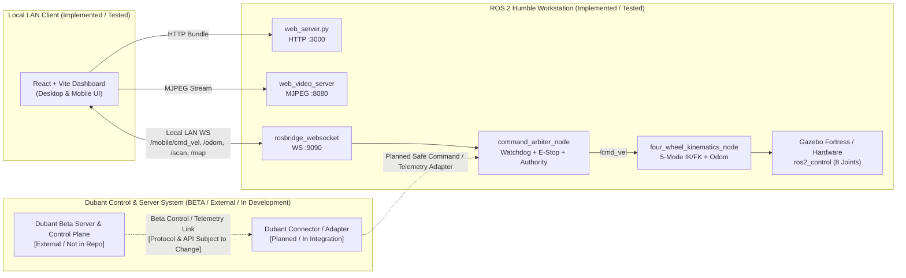

# Dubant Control and Server Integration (BETA)

> [!WARNING]
> **BETA SOFTWARE NOTICE:** `4ws_robot` currently uses a beta version of the Dubant control/server system. This integration is under active development and testing. Features, interfaces, APIs, and operational behaviour may change. It should not be considered a production-ready remote robotics control platform.

---

## Table of Contents

1. [Overview and Purpose](#1-overview-and-purpose)
2. [Current Codebase Verification](#2-current-codebase-verification)
3. [Role in Robot Control and Server Communication](#3-role-in-robot-control-and-server-communication)
4. [Architecture and Boundary Separation](#4-architecture-and-boundary-separation)
5. [Communication Protocols, Endpoints, and Auth Status](#5-communication-protocols-endpoints-and-auth-status)
6. [Data Flow and Control Flow](#6-data-flow-and-control-flow)
7. [Integration Status Matrix](#7-integration-status-matrix)
8. [Known Limitations and Beta Risks](#8-known-limitations-and-beta-risks)
9. [Testing Status](#9-testing-status)
10. [Future Development Requirements](#10-future-development-requirements)

---

## 1. Overview and Purpose

In the broader `4ws_robot` architecture, **Dubant** is an external control and server-based robotics control system intended to manage robot control coordination and server-side communication beyond standalone local workstation launches.

**Why it is used in `4ws_robot`:**

- Centralizes server-assisted robot supervision and remote operator coordination alongside the ROS 2 autonomy stack.
- Provides a path toward decoupling web client sessions from direct LAN-only ROS 2 WebSocket exposure.
- Supports iterative testing of multi-channel control workflows while keeping the underlying ROS 2 kinematics (`four_wheel_control`), safety arbitration (`command_arbiter_node`), and Gazebo Fortress physics layers unchanged.

---

## 2. Current Codebase Verification

A direct audit of all source directories (`src/`, `config/`, `launch/`, `scripts/`, and `frontend/src/`) confirms the following factual boundary in this repository snapshot:

- **Currently implemented and runnable in this repository (`IMPLEMENTED` / `TESTED`):** Local LAN browser-to-ROS communication using `web_server.py` (HTTP port `3000`), `rosbridge_websocket` (WebSocket port `9090`), and `web_video_server` (MJPEG HTTP port `8080`), feeding `command_arbiter_node` in `four_wheel_mobile_control`.
- **Dubant integration status (`IN DEVELOPMENT` / `PLANNED` / `NOT VERIFIED` in this codebase):** No Dubant server source code, client SDK modules, authentication handlers, or server URLs are committed inside this public repository snapshot. Placeholder configuration variables are provided in [`.env.example`](../.env.example) (`DUBANT_SERVER_URL`, `DUBANT_AUTH_TOKEN`, `DUBANT_ROBOT_ID`) for external integration environments only.

Do not confuse the local `rosbridge_websocket` LAN bridge with the Dubant server control system; they are distinct architectural layers.

---

## 3. Role in Robot Control and Server Communication

When paired with `4ws_robot` during external testing:

- **Role in Robot Control:** Dubant operates above the ROS 2 motion-control stack as an external server/control coordinator. Regardless of upstream command source, all velocity commands targeting the physical or simulated `4WS/4WD` base are expected to pass through the ROS 2 `command_arbiter_node` safety layer (`/mobile/cmd_vel` or future bridged topics) so E-Stop latching and watchdog rules remain enforced locally on the robot side.
- **Role in Server-Based Communication:** Dubant is intended to broker server-mediated telemetry and control sessions rather than requiring operator browsers to connect exclusively over an open local-area network WebSocket.

---

## 4. Architecture and Boundary Separation

The diagram below distinguishes the **existing local runtime stack** (implemented in this repository) from the **external Dubant beta server component** (under active external development and not yet bundled in this repo).

---

## 5. Communication Protocols, Endpoints, and Auth Status

Because the Dubant beta server implementation is maintained externally and is not yet merged into this repository:

| Interface Aspect | Local LAN Runtime (Implemented) | Dubant Beta Integration (External / In Development) |
| :--- | :--- | :--- |
| **Transport Protocol** | HTTP (`:3000`, `:8080`), WebSocket WS (`:9090`) | **NOT VERIFIED / NOT IN REPO** (depends on external Dubant beta build) |
| **Server Endpoints** | `/api/health`, `/api/config` on local `web_server`; local `ws://<ROBOT_IP>:9090` | **NOT PUBLISHED** (placeholder `DUBANT_SERVER_URL` in `.env.example` only; no production or private URLs are shipped) |
| **Authentication / Authorization** | None built-in on local `rosbridge` (LAN firewall recommended per [mobile_network_setup.md](mobile_network_setup.md)) | **NOT IMPLEMENTED IN REPO** (placeholder `DUBANT_AUTH_TOKEN`; auth flows are part of ongoing external Dubant beta development) |

---

## 6. Data Flow and Control Flow

1. **Current Verified Flow (Local Mode):** Operator inputs from the Desktop Keyboard (`W/A/S/D/Q/E/Space`), Desktop Mouse Joystick, or Mobile Touch Joystick pass through `manualInputPipeline.ts` in the browser, publish over local `rosbridge_websocket` to `/mobile/cmd_vel` at `10 Hz`, and enter `command_arbiter_node`. `command_arbiter_node` validates `MANUAL` authority, non-latched E-Stop, and the `0.40 s` monotonic watchdog before forwarding `/cmd_vel` to `four_wheel_kinematics_node`.
2. **Intended Beta Integration Flow (External Mode — Under Development):** Upstream commands and state synchronization managed by the Dubant beta control server will interface with `4ws_robot` through a dedicated connector/adapter configured via environment variables without bypassing `command_arbiter_node` safety checks.

---

## 7. Integration Status Matrix

| Capability | Status Label | Notes |
| :--- | :--- | :--- |
| Local LAN dashboard + `rosbridge` control | `TESTED` | Verified across Desktop, Tablet, and Mobile viewports in live headless Chrome + Gazebo Fortress simulation |
| Local E-Stop latch, watchdog timeout, authority lock | `TESTED` | Verified in Python integration tests (`tests/test_mobile_control_suite.py`) and browser E2E checks |
| Environment variable placeholders (`.env.example`) | `IMPLEMENTED` | Non-secret placeholders for `DUBANT_SERVER_URL`, `DUBANT_AUTH_TOKEN`, `DUBANT_ROBOT_ID` |
| Dubant beta server-side control transport | `IN DEVELOPMENT` | External beta system under active testing; not committed to this repository |
| End-to-end authenticated remote / cloud teleoperation | `NOT VERIFIED` | Must not be assumed functional or safe over untrusted networks until validated |
| Automated CI/CD or ROS bridge test suite against Dubant server | `PLANNED` | Blocked until Dubant beta adapter API stabilizes |

---

## 8. Known Limitations and Beta Risks

- **No Cloud or Remote Internet Verification:** Remote operation over WAN/internet through Dubant has **not** been tested or verified in this repository.
- **Unfrozen APIs:** Dubant beta endpoints, payload schemas, and session contracts are still changing during development.
- **Latency and Watchdog Sensitivity:** `command_arbiter_node` currently enforces a strict `0.40 s` (`watchdog_timeout`) deadline on manual velocity commands; WAN jitter or server-hop latency above `400 ms` will trip `watchdog_stop` unless latency budgets or edge buffering are explicitly engineered.
- **No Built-In TLS/Auth in Local Mode:** Local `rosbridge` uses unencrypted `ws://` (`:9090`); any remote exposure must use a proper authenticated reverse proxy (`wss://`) or wait for verified Dubant server authentication.
- **Missing Adapter Code in Public Snapshot:** Cloned installations of this repository run in local LAN/workstation simulation mode out of the box and do not include private Dubant beta server binaries or credentials.

---

## 9. Testing Status

- **Verified:** Local UI, manual input pipeline, `command_arbiter_node`, Nav2 goal dispatch, SLAM, and Gazebo Fortress simulation have all been tested locally.
- **Not Verified:** No automated or manual end-to-end test in `tests/` connects to a live Dubant beta server instance.

---

## 10. Future Development Requirements

To graduate the Dubant integration out of beta inside `4ws_robot`:

1. Finalize and freeze the Dubant server control and telemetry protocol specification.
2. Implement and commit an open/clean ROS 2 adapter node (or frontend transport service) behind an explicit feature toggle with `.env` configuration.
3. Enforce token-based authentication, role authorization, and TLS (`https://` / `wss://`) for every server-mediated control channel.
4. Benchmark round-trip latency and jitter against `command_arbiter_node`'s monotonic watchdog and safety failover rules.
5. Add automated integration tests validating graceful failover to local `MANUAL` / `ESTOP` if the Dubant server connection drops.

