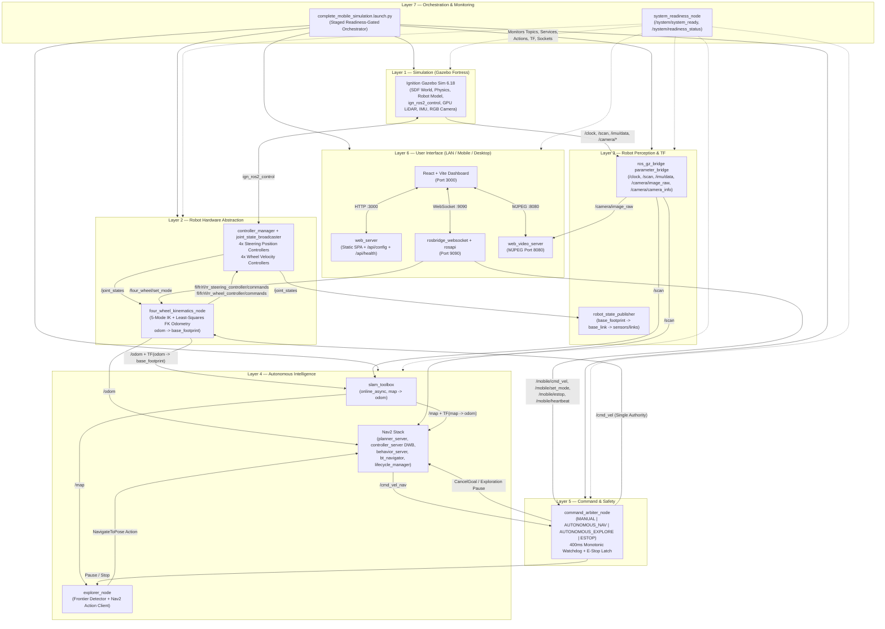

# 4ws_robot — Complete 4WS/4WD System Architecture

## 1. Overview

`4ws_robot` is an integrated ROS 2 Humble, Gazebo Fortress, `ros2_control`, SLAM Toolbox, Nav2, Frontier Exploration, and React/Vite mobile-control robotics platform for an **8-DOF Four-Wheel Steering / Four-Wheel Drive (4WS/4WD)** autonomous mobile robot.

The architecture is organized into **7 strictly decoupled layers** so that simulation, hardware abstraction, perception, autonomy, safety arbitration, user interface, and lifecycle orchestration operate as one cohesive system via a single master launch command:

```bash
ros2 launch four_wheel_mobile_control complete_mobile_simulation.launch.py
```

---

## 2. Seven-Layer System Architecture Diagram



---

## 3. Layer-by-Layer Breakdown

### Layer 1 — Simulation (`four_wheel_description`)
- **Simulator:** Gazebo Fortress (Ignition Gazebo Sim 6.18) via `ros_gz_sim`.
- **World Loading:** Accepts any validated Fortress-compatible SDF world via `world:=<path>`. Built-in worlds:
  - `outdoor_proving_ground.sdf` (default — 4-sector proving ground with perimeter walls and obstacles)
  - `four_wheel_arena.sdf` (compact indoor arena)
- **Robot Model:** `robot.urdf.xacro` composed of `chassis.xacro`, `steering.xacro`, `wheel.xacro`, `sensors.xacro`, `ros2_control.xacro`, and `materials.xacro`.
  - Wheelbase `L = 0.36 m` (`a = 0.18 m`), track width `W = 0.36 m` (`b = 0.18 m`), wheel radius `r = 0.08 m`.
  - 8 actuated joints: 4 revolute steering knuckles (`fl/fr/rl/rr_steering_joint`, `±π/2 rad`) and 4 continuous driven wheels (`fl/fr/rl/rr_wheel_joint`, `±25 rad/s`).
- **Physics & Hardware Plugin:** `ign_ros2_control/IgnitionSystem` manages joint interfaces inside Gazebo at 50 Hz controller update rate.

### Layer 2 — Robot Hardware Abstraction (`four_wheel_control`)
- **Controller Manager & Spawners:**
  - `joint_state_broadcaster` (`joint_state_broadcaster/JointStateBroadcaster`) -> publishes `/joint_states`
  - `fl_steering_controller`, `fr_steering_controller`, `rl_steering_controller`, `rr_steering_controller` (`position_controllers/JointGroupPositionController`)
  - `fl_wheel_controller`, `fr_wheel_controller`, `rl_wheel_controller`, `rr_wheel_controller` (`velocity_controllers/JointGroupVelocityController`)
- **Kinematics & Odometry (`four_wheel_kinematics_node`):**
  - Subscribes to `/cmd_vel` (`geometry_msgs/Twist`), `/four_wheel/set_mode` (`std_msgs/String`), `/joint_states` (`sensor_msgs/JointState`).
  - Supports 5 steering modes:
    1. `front_steer` (Mode A — Front Ackermann, rear wheels locked at 0)
    2. `four_wheel_steer` (Mode B — Counter-phase front/rear opposite steering)
    3. `crab` (Mode C — All 4 wheels steer parallel for lateral/diagonal translation)
    4. `generalized` (Mode D — Universal planar ICR swerve for simultaneous `(vx, vy, wz)`)
    5. `in_place_spin` (Mode E — Tangential `±45°` wheel alignment for pure yaw rotation)
  - Computes closed-form analytical least-squares forward kinematics from measured steering angles and wheel velocities to publish `/odom` (`nav_msgs/Odometry`) and broadcast TF `odom -> base_footprint`.
  - Single authoritative publisher of `/odom` and `odom -> base_footprint`.

### Layer 3 — Robot Perception & TF (`four_wheel_description`)
- **`ros_gz_bridge` (`parameter_bridge`):**
  - `/clock` (`rosgraph_msgs/Clock` ← `ignition.msgs.Clock`)
  - `/scan` (`sensor_msgs/LaserScan` ← `ignition.msgs.LaserScan`, 360°, 720 beams, 0.1–20.0 m, 15 Hz, `lidar_link`)
  - `/imu/data` (`sensor_msgs/Imu` ← `ignition.msgs.IMU`, 50 Hz, `imu_link`)
  - `/camera/image_raw` (`sensor_msgs/Image` ← `ignition.msgs.Image`, 640×480 `rgb8`, 15 Hz, `camera_optical_link`)
  - `/camera/camera_info` (`sensor_msgs/CameraInfo` ← `ignition.msgs.CameraInfo`)
- **TF Tree:**
  ```text
  map                        (slam_toolbox)
   └── odom                  (four_wheel_kinematics_node)
        └── base_footprint   (robot_state_publisher)
             └── base_link
                  ├── lidar_link
                  ├── imu_link
                  ├── camera_link -> camera_optical_link
                  └── {fl,fr,rl,rr}_knuckle_link -> {fl,fr,rl,rr}_wheel_link
  ```

### Layer 4 — Autonomous Intelligence (`four_wheel_navigation`, `four_wheel_exploration`)
- **Online SLAM (`slam_toolbox` `async_slam_toolbox_node`):**
  - Consumes `/scan` + TF `odom -> base_footprint`.
  - Publishes `/map` (`nav_msgs/OccupancyGrid`) and owns `map -> odom` exclusively (AMCL is **never** launched during online SLAM).
- **Nav2 Stack:**
  - `planner_server` (`NavfnPlanner`) generates global paths on `/plan` using global costmap (`/map` + `/scan` + inflation).
  - `controller_server` (`dwb_core::DWBLocalPlanner`) outputs holonomic `(vx, vy, wz)` velocity commands remapped to **`/cmd_vel_nav`** (never directly to `/cmd_vel`).
  - `behavior_server` (`Spin`, `BackUp`, `Wait`) remapped to **`/cmd_vel_nav`**.
  - `bt_navigator` hosts `navigate_to_pose` action server (`remappings=[('cmd_vel', cmd_vel_topic)]`).
  - `lifecycle_manager_navigation` transitions all 4 Nav2 nodes through `configure -> activate`.
- **Frontier Exploration (`explorer_node`):**
  - Subscribes to `/map`, uses TF `map -> base_footprint`.
  - Detects unknown/free boundary cells (`FrontierDetector`), clusters via BFS, filters by minimum size and distance-transform obstacle clearance, scores & selects frontier goals, maintains a timed failed-goal blacklist, and dispatches goals **exclusively** via the Nav2 `navigate_to_pose` action client.
  - Exposes `/exploration/start`, `/exploration/pause`, `/exploration/resume`, `/exploration/stop` (`std_srvs/Trigger`), and publishes `/exploration/status`, `/exploration/coverage`, `/exploration/frontiers`, `/exploration/current_goal`.

### Layer 5 — Command & Safety (`four_wheel_mobile_control`)
- **`command_arbiter_node`:** Single motion authority publishing `/cmd_vel` to `four_wheel_kinematics_node`.
- **Operating States:** `MANUAL`, `AUTONOMOUS_NAV`, `AUTONOMOUS_EXPLORE`, `ESTOP`.
- **Safety Policies:**
  - **E-Stop:** Highest priority; immediately outputs zero `Twist`, latches `ESTOP` until explicit reset (`/mobile/reset_estop` or `/mobile/estop=false`), cancels active Nav2 goals via `navigate_to_pose/_action/cancel_goal`, pauses exploration, and clears buffered velocity commands so a fresh command is required post-reset.
  - **Watchdog (400 ms monotonic):** Uses `time.monotonic()` so a paused Gazebo `/clock` cannot freeze safety timeouts. Separately tracks `/mobile/cmd_vel` freshness and `/mobile/heartbeat` freshness so a connected browser never holds a stale nonzero joystick command alive.
  - **Speed Limiting & Clamping:** Scales manual commands by active speed limit (`0.1–1.0`) and clamps to `max_linear_vel` (`1.5 m/s`) and `max_angular_vel` (`2.0 rad/s`).
  - **Mode Transition Lockout:** Enforces a 150 ms zero-velocity pause when switching operating modes.

### Layer 6 — User Interface (`four_wheel_mobile_control`)
- **`web_server` (Port `3000`, `0.0.0.0`):** Serves built React/Vite SPA (`frontend/dist`), exposes `/api/config` (dynamic LAN IPs, ports, topics) and `/api/health`.
- **`rosbridge_websocket` + `rosapi` (Port `9090`, `0.0.0.0`):** WebSocket JSON bridge for `roslibjs`.
- **`web_video_server` (Port `8080`, `0.0.0.0`):** Streams `/camera/image_raw` as live MJPEG over HTTP.
- **React Mobile & Desktop Dashboard:** Responsive UI with live map + path overlay, live LiDAR canvas, MJPEG camera stream, 5-mode steering selector, 4-state operating mode selector, prominent E-Stop banner, virtual omnidirectional joystick with continuous 10 Hz hold-publish & dead-man release, and telemetry panel.

### Layer 7 — Orchestration & Monitoring (`four_wheel_mobile_control`)
- **`complete_mobile_simulation.launch.py`:** Validates world SDF, resolves parameter files safely, enforces readiness-gated startup sequencing across Simulation → Controllers/Kinematics → Sensors/TF → SLAM → Nav2 → Exploration → Mobile Stack → RViz2 → System Readiness Monitor.
- **`system_readiness_node`:** Probes real runtime evidence (Gazebo `/clock` advance, 8 joints in `/joint_states`, active controllers via `/controller_manager/list_controllers`, `/odom`, TF connectivity, `/scan`, `/imu/data`, `/camera/image_raw`, `/map`, Nav2 lifecycle states + `navigate_to_pose`, `/exploration/start`, `/mobile/arbiter_status`, HTTP `/api/health`, rosbridge WebSocket handshake, video server HTTP response). Publishes latched `/system/system_ready` (`Bool`) and periodic JSON health on `/system/readiness_status` (`STARTING`, `READY`, `DEGRADED`, `FAILED`, `STOPPING`).

---

## 4. Major ROS 2 Interfaces Reference

### Topics
| Topic | Type | Publisher | Subscribers |
|---|---|---|---|
| `/clock` | `rosgraph_msgs/Clock` | `parameter_bridge` | All (`use_sim_time=true`) |
| `/joint_states` | `sensor_msgs/JointState` | `joint_state_broadcaster` | `robot_state_publisher`, `four_wheel_kinematics_node`, `system_readiness_node` |
| `/fl_steering_controller/commands` .. `/rr_steering_controller/commands` | `std_msgs/Float64MultiArray` | `four_wheel_kinematics_node` | `ros2_control` steering position controllers |
| `/fl_wheel_controller/commands` .. `/rr_wheel_controller/commands` | `std_msgs/Float64MultiArray` | `four_wheel_kinematics_node` | `ros2_control` wheel velocity controllers |
| `/odom` | `nav_msgs/Odometry` | `four_wheel_kinematics_node` | Nav2, Dashboard, `system_readiness_node` |
| `/scan` | `sensor_msgs/LaserScan` | `parameter_bridge` | `slam_toolbox`, Nav2 costmaps, Dashboard, `system_readiness_node` |
| `/imu/data` | `sensor_msgs/Imu` | `parameter_bridge` | `system_readiness_node` |
| `/camera/image_raw` | `sensor_msgs/Image` | `parameter_bridge` | `web_video_server`, `system_readiness_node` |
| `/camera/camera_info` | `sensor_msgs/CameraInfo` | `parameter_bridge` | Camera consumers |
| `/map` | `nav_msgs/OccupancyGrid` | `slam_toolbox` | Nav2 global costmap, `explorer_node`, Dashboard, `system_readiness_node` |
| `/plan` | `nav_msgs/Path` | `planner_server` | Dashboard |
| `/mobile/cmd_vel` | `geometry_msgs/Twist` | Dashboard (`rosbridge`) | `command_arbiter_node` |
| `/cmd_vel_nav` | `geometry_msgs/Twist` | `controller_server`, `behavior_server` | `command_arbiter_node` |
| `/cmd_vel` | `geometry_msgs/Twist` | `command_arbiter_node` | `four_wheel_kinematics_node` |
| `/mobile/heartbeat` | `std_msgs/Empty` | Dashboard (`rosbridge`) | `command_arbiter_node` |
| `/mobile/set_mode` | `std_msgs/String` | Dashboard (`rosbridge`) | `command_arbiter_node` |
| `/mobile/estop` | `std_msgs/Bool` | Dashboard (`rosbridge`) | `command_arbiter_node` |
| `/mobile/set_speed_limit` | `std_msgs/Float32` | Dashboard (`rosbridge`) | `command_arbiter_node` |
| `/mobile/arbiter_status` | `std_msgs/String` (JSON) | `command_arbiter_node` | Dashboard, `system_readiness_node` |
| `/mobile/estop_status` | `std_msgs/Bool` | `command_arbiter_node` | Dashboard |
| `/four_wheel/set_mode` | `std_msgs/String` | Dashboard (`rosbridge`) | `four_wheel_kinematics_node` |
| `/four_wheel/current_mode` | `std_msgs/String` | `four_wheel_kinematics_node` | Dashboard |
| `/exploration/status` | `std_msgs/String` | `explorer_node` | Dashboard, `system_readiness_node` |
| `/exploration/coverage` | `std_msgs/String` (JSON) | `explorer_node` | Dashboard |
| `/exploration/frontiers` | `visualization_msgs/MarkerArray` | `explorer_node` | RViz2 |
| `/system/system_ready` | `std_msgs/Bool` | `system_readiness_node` | Monitoring tools |
| `/system/readiness_status` | `std_msgs/String` (JSON) | `system_readiness_node` | Monitoring tools |

### Services & Actions
| Interface | Type | Server | Clients |
|---|---|---|---|
| `navigate_to_pose` (Action) | `nav2_msgs/NavigateToPose` | `bt_navigator` | `explorer_node`, Dashboard, `system_readiness_node` |
| `navigate_to_pose/_action/cancel_goal` | `action_msgs/CancelGoal` | `bt_navigator` | `command_arbiter_node` |
| `/mobile/trigger_estop`, `/mobile/reset_estop` | `std_srvs/Trigger` | `command_arbiter_node` | Dashboard |
| `/exploration/start`, `/pause`, `/resume`, `/stop` | `std_srvs/Trigger` | `explorer_node` | Dashboard, `command_arbiter_node`, `system_readiness_node` |
| `/controller_manager/list_controllers` | `controller_manager_msgs/ListControllers` | `controller_manager` | `system_readiness_node` |

