# Visual Documentation Gallery

This gallery catalogs verified visual outputs captured from `4ws_robot` across Gazebo Fortress simulation, PyBullet geometry checks, RViz2 sensor visualization, SLAM Toolbox mapping, Nav2 navigation, autonomous frontier exploration, and the pixel-art Desktop + Mobile ground-control dashboard.

---

## 1. Ground-Control Dashboard (Desktop, Tablet, and Mobile UI)

### 1.1 Desktop Ground-Control Station (`1440x900`)

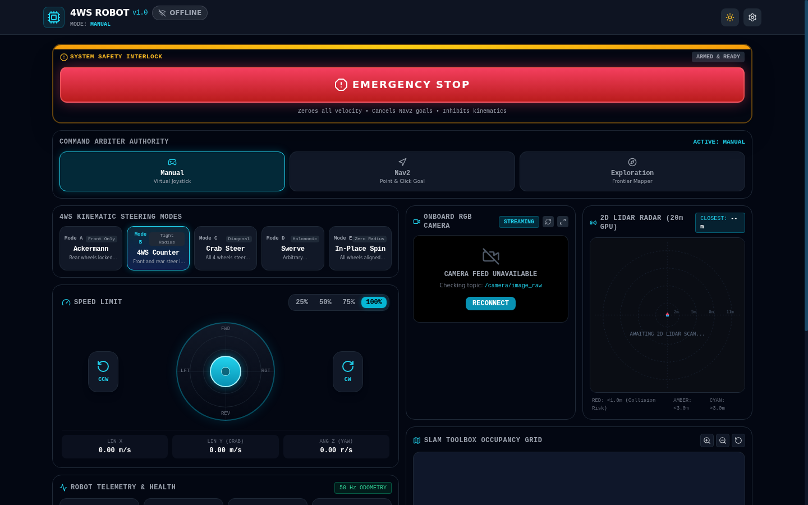

**Demonstrates:** Live desktop workstation layout running against Gazebo Fortress over `rosbridge_websocket` (`:9090`) and `web_video_server` (`:8080`). Displays header telemetry (`CONNECTED`, `GAZEBO (SIM)`, FPS, latency), left section navigation rail, sticky `SYSTEM SAFETY INTERLOCK` (`ARMED & READY`, `EMERGENCY STOP`), `CONTROL AUTHORITY` (`MANUAL` / `NAV2` / `EXPLORE`), five 4WS steering modes (`D. SWERVE` active), speed limit bar, manual joystick + desktop keyboard indicator (`W/A/S/D/Q/E/Space`), top-down wheel steering angle visualizer, live RGB camera stream, 360-degree LiDAR polar scan, and IMU orientation view.

### 1.2 Mobile One-Handed Pilot Interface — Right-Handed (`412x915`)

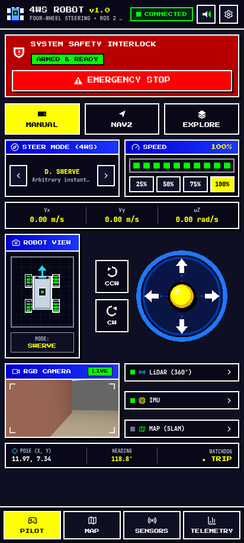

**Demonstrates:** Mobile phone layout with right-thumb placement for the omnidirectional joystick and `CCW` / `CW` rotation controls, left-aligned Top-Down Robot View, collapsible sensor jump rows (`LiDAR`, `IMU`, `MAP`), live odometry/watchdog strip, sticky E-Stop interlock, and sticky bottom tabs (`PILOT`, `MAP`, `SENSORS`, `TELEMETRY`).

### 1.3 Mobile One-Handed Pilot Interface — Left-Handed (`412x915`)

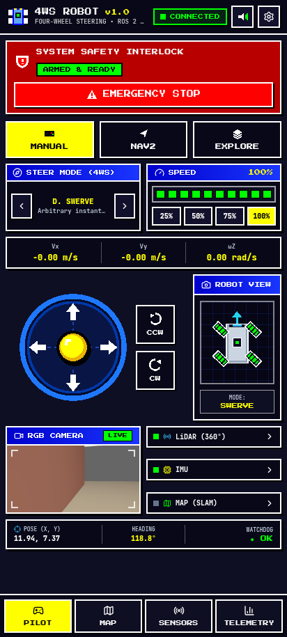

**Demonstrates:** Left-handed mobile configuration toggled from the Settings modal, mirroring the joystick and `CCW`/`CW` rotation buttons to the left side and moving the Top-Down Robot View (showing diagonal swerve wheel deflections) to the right.

### 1.4 Tablet Responsive Layout (`768x1024`)

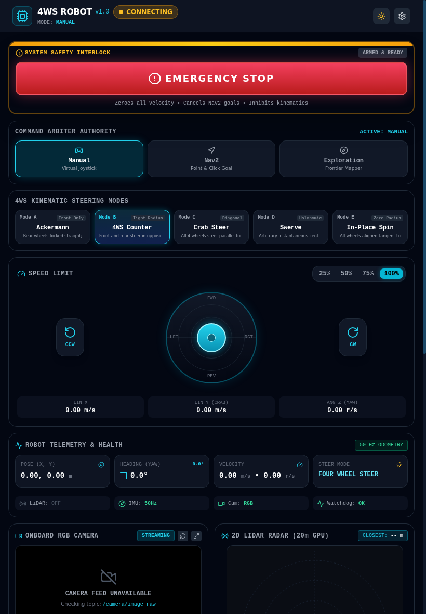

**Demonstrates:** Responsive tablet presentation preserving single-column safety banner hierarchy, full status badges, touchscreen joystick, live camera feed, and sticky tab bar without horizontal overflow.

---

## 2. Gazebo Simulation and RViz2 Visualization

| Gazebo Fortress Arena Spawn | RViz2 Live Sensor & TF Model |
| :---: | :---: |
|  |  |

| RViz2 Front View | RViz2 Side View | RViz2 Top View |
| :---: | :---: | :---: |
| 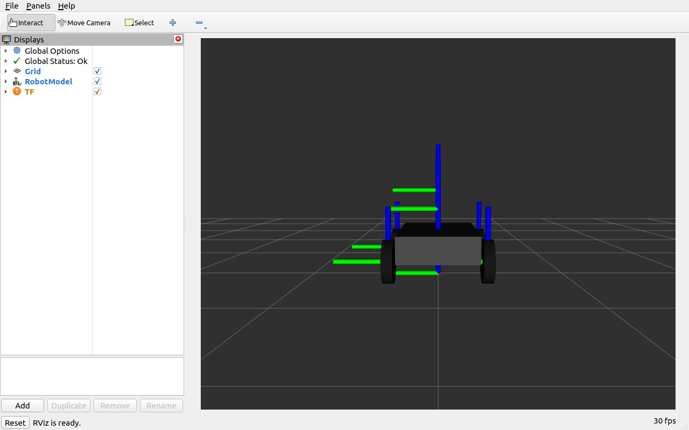 | 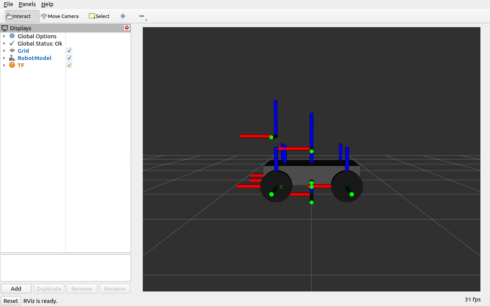 | 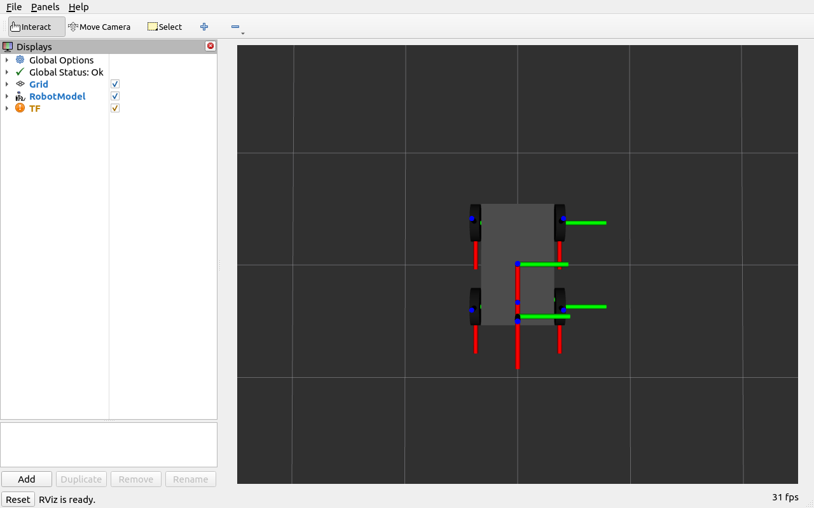 |

**Demonstrates:** Eight actuated joints rendered in Ignition Gazebo Fortress alongside RViz2 TF frames, URDF link geometry, 720-beam LiDAR scan overlay, and IMU/odometry frame transforms (`map -> odom -> base_footprint -> base_link`).

---

## 3. Robot 3D Geometry and 4WS Steering Configurations

| Steering Modes Overview | Isometric 3D Model |
| :---: | :---: |
| 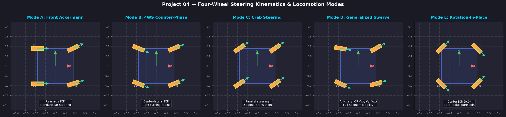 | 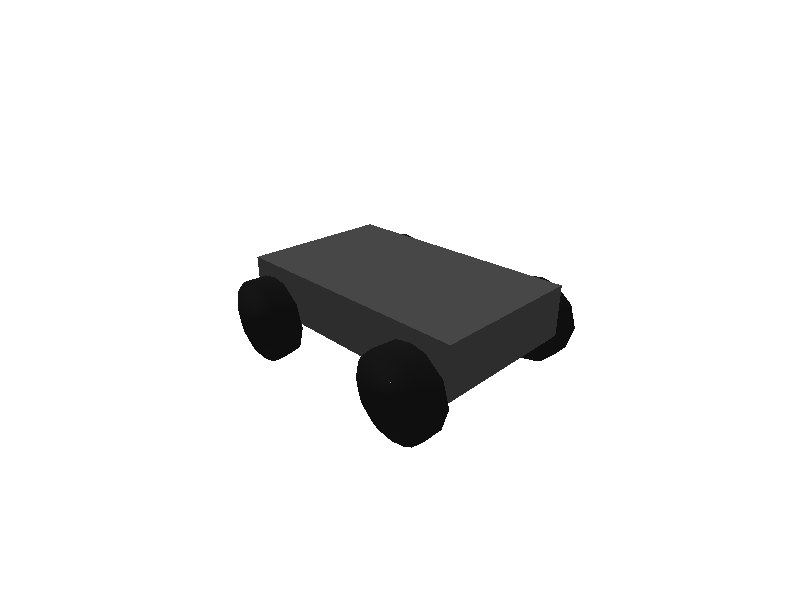 |

| Mode B: Counter-Phase 4WS | Mode C: Crab Parallel | Mode E: Rotation-In-Place |
| :---: | :---: | :---: |
| 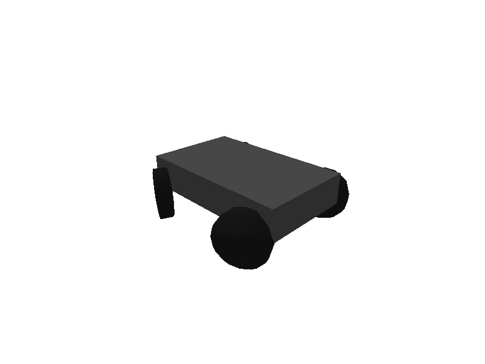 | 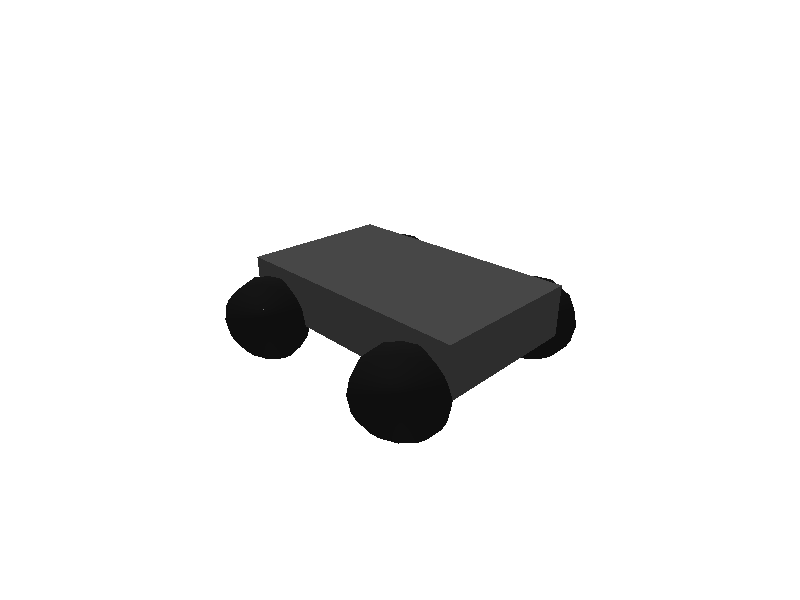 | 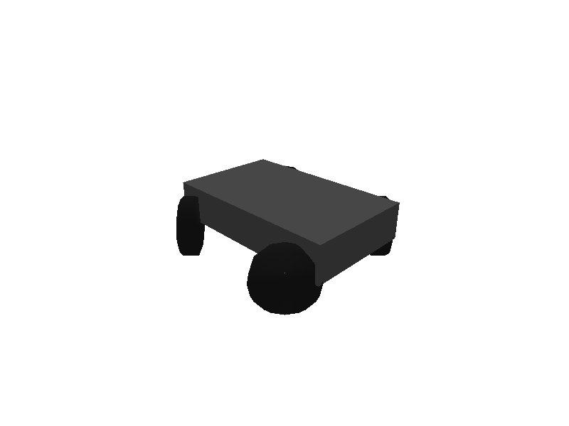 |

**Demonstrates:** Physical wheel-knuckle geometry across Ackermann, symmetric counter-phase 4WS (`+25/-25 deg`), parallel crab translation (`+35 deg` all corners), and tangential rotation-in-place (`+/-45 deg`).

---

## 4. SLAM Mapping, Nav2 Path Planning, and Autonomous Exploration

| SLAM Toolbox Occupancy Grid | Nav2 Planned Trajectory | Frontier-Based Autonomous Exploration |
| :---: | :---: | :---: |
| 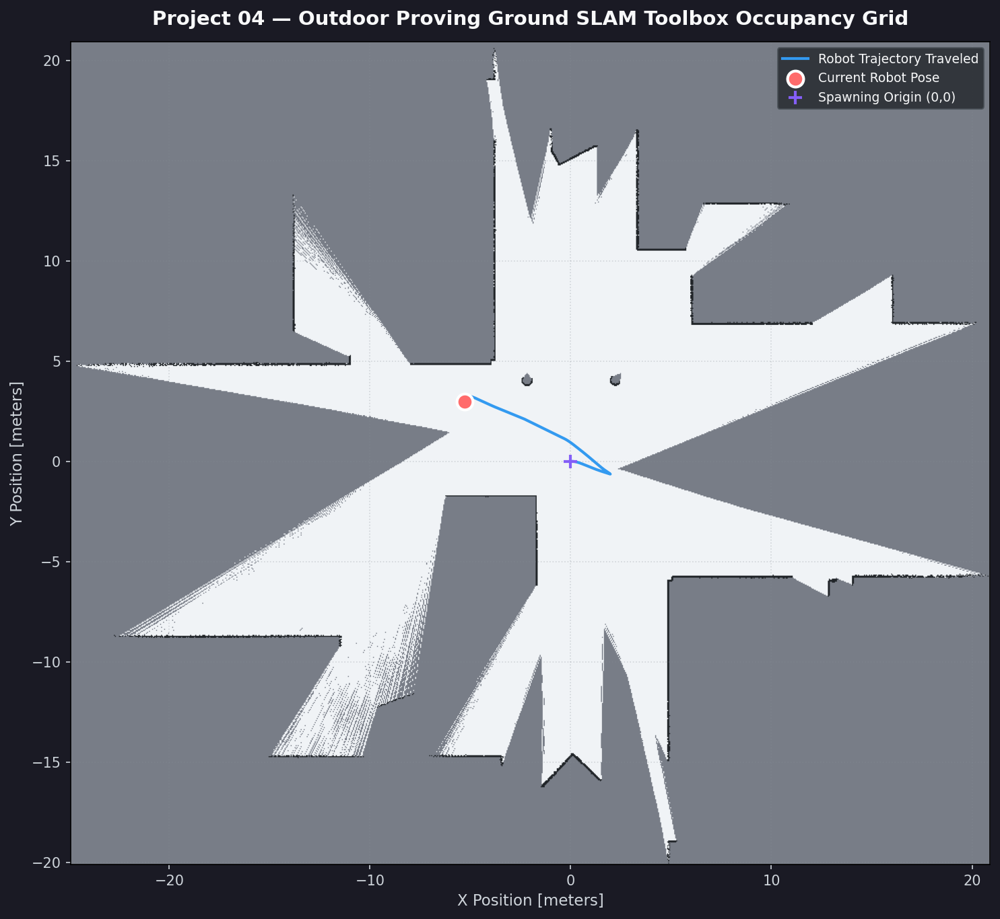 | 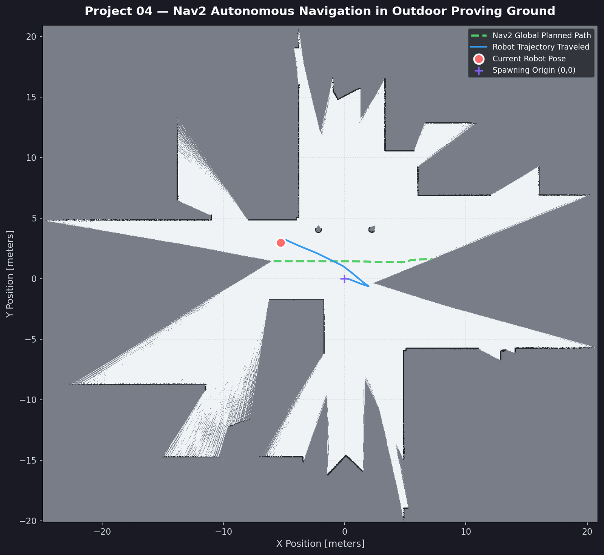 | 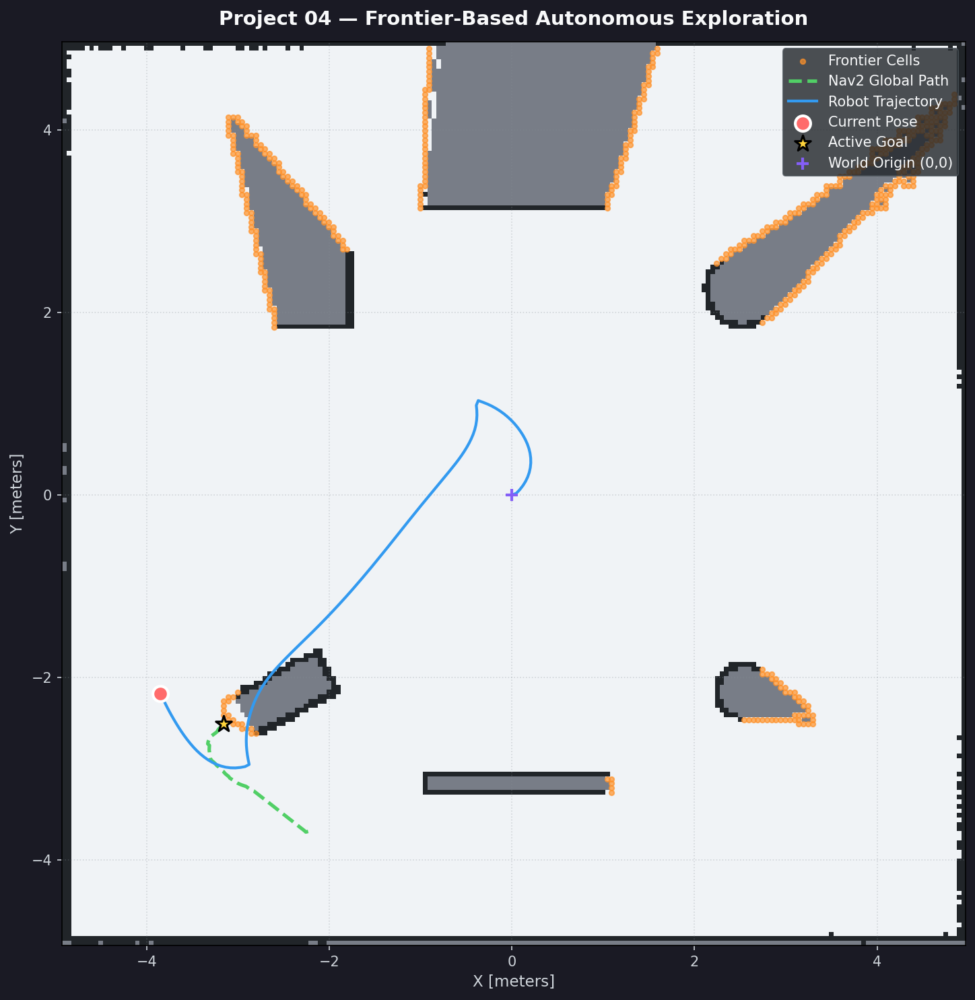 |

**Demonstrates:** Online asynchronous `slam_toolbox` 5 cm occupancy grid generation (`odom -> map` loop closure), Nav2 DWB/Navfn path execution around obstacles, and frontier clustering/goal selection during automated arena mapping.

---

## 5. Ground-Control UI Color Reference and Visual Identity

Implemented in [`tailwind.config.js`](../src/four_wheel_mobile_control/frontend/tailwind.config.js) and [`index.css`](../src/four_wheel_mobile_control/frontend/src/index.css):

| Token / Semantic Role | Hex Code | Usage in `4ws_robot` Dashboard |
| :--- | :--- | :--- |
| Primary Alert / E-Stop | `#FF0000` | Emergency Stop trigger, critical LiDAR threshold, disconnected alert |
| Active / Armed / Ready | `#00FF00` | `ARMED & READY`, `CONNECTED` pill, `ENABLED` keyboard indicator, active steering mode |
| Control Blue / Header | `#0000FF` | Primary control panel headers and focus-border accents (paired with `#0000CC` / `#1028C8`) |
| Caution / Active Direction | `#FFFF00` | Active authority button (`MANUAL`), joystick thumb sphere, keyboard `:focus-visible` ring, hazard stripes |
| Deep Canvas Background | `#0F0F23` | Global workspace background canvas (with `#080818` and `#11112B` nested panel fills) |
| Crisp Border / Primary Text | `#FFFFFF` | Hard 2 px square-cornered panel/button borders and primary text |
| Shadow / High-Contrast Ink | `#000000` | Hard offset pixel shadows (`3px 3px 0px #000000`) and dark text on `#FFFF00` / `#00FF00` buttons |

- **Typography:** `Press Start 2P` (`font-pixel`) for panel headers, mode labels, and status indicators; `JetBrains Mono` (`font-mono`) for dense numeric odometry, steering angles, IMU readouts, and system logs.
- **Accessibility & Responsive Design:** High-contrast `#FFFF00` `3px` `:focus-visible` outline, `@media (prefers-reduced-motion: reduce)` motion suppression, desktop workstation layout (`>= 1024 px`), and one-handed Left/Right-Handed mobile layout (`< 1024 px`).

