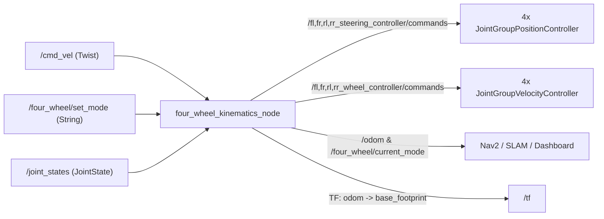

# `four_wheel_control`

Five-mode 4WS/4WD kinematic solver, closed-form least-squares planar odometry estimator, `ros2_control` configuration, and terminal keyboard teleoperation for Project 04.

---

## 1. Purpose

Translates high-level planar chassis twist commands (`geometry_msgs/Twist` on `/cmd_vel`) into individualized position targets for four steering knuckles and angular velocity targets for four drive wheels, while reconstructing odometry (`/odom` and `odom -> base_footprint` TF) from measured joint feedback.

---

## 2. Architecture and Data Flow



### Key Files

| File | Responsibility |
| :--- | :--- |
| `four_wheel_control/kinematics.py` | `FourWheelKinematics` pure-Python/NumPy IK (`A-E`) and least-squares FK solver |
| `four_wheel_control/four_wheel_kinematics_node.py` | ROS 2 `50 Hz` control and odometry node |
| `four_wheel_control/teleop_keyboard.py` | Standalone ROS 2 terminal teleoperation node (`1-5` mode switch, `Space` stop) |
| `config/ros2_controllers.yaml` | `controller_manager` (`50 Hz`) + `joint_state_broadcaster` + 8 per-wheel controllers |
| `launch/control.launch.py` | Starts `four_wheel_kinematics_node` with geometry and timeout parameters |
| `launch/teleop.launch.py` | Starts interactive terminal keyboard teleoperation |

### Supported Locomotion Modes

| Mode ID | Name | Kinematic Behaviour |
| :--- | :--- | :--- |
| `front_steer` | Mode A: Front Ackermann | Inner/outer front knuckle Ackermann geometry; rear knuckles remain `0 rad` |
| `four_wheel_steer` | Mode B: 4WS Counter-Phase | Front and rear knuckles steer opposite symmetrically for tightened turning radius |
| `crab` | Mode C: Crab Steering | All 4 knuckles steer parallel for lateral/diagonal translation without yaw rotation |
| `generalized` | Mode D: Swerve / Holonomic | Evaluates $v_x - \omega_z y_i$ and $v_y + \omega_z x_i$ independently per corner |
| `in_place_spin` | Mode E: Rotation-In-Place | Aligns wheels tangentially (`+/-atan2(b, a)`) around chassis centroid for zero-radius rotation |

---

## 3. Forward and Inverse Kinematics

- **Inverse Kinematics (`compute_ik`):** Computes wheel steering angle $\delta_i$ and tangential wheel linear velocity from $(v_x, v_y, \omega_z)$ for corner positions $(\pm 0.18\text{ m}, \pm 0.18\text{ m})$, folds steering angles into $[-\pi/2, +\pi/2]$ with wheel speed sign inversion to minimize knuckle travel, and clamps to `max_steering_angle` (`1.5708 rad`) and `max_wheel_speed` (`20.0 rad/s` default in `FourWheelKinematics`, `25.0 rad/s` override in `control.launch.py`). Note: non-zero `vy` commands in `front_steer` or `four_wheel_steer` automatically switch into `crab` or `generalized` handling when triggered by holonomic planners.
- **Forward Kinematics (`compute_fk`):** Forms the overdetermined $8 \times 3$ planar velocity Jacobian from measured steering angles and wheel angular speeds in `/joint_states`, solves $(v_x, v_y, \omega_z)$ via pseudo-inverse least squares, and integrates pose using `/joint_states` header timestamps when available.

---

## 4. Dependencies, Build, and Execution

**Dependencies:** `rclpy`, `geometry_msgs`, `nav_msgs`, `sensor_msgs`, `std_msgs`, `tf2_ros`, `python3-numpy`.

```bash
export PYTHONNOUSERSITE=1
source /opt/ros/humble/setup.bash
colcon build --packages-select four_wheel_control
source install/setup.bash
```

Launch kinematics node:

```bash
ros2 launch four_wheel_control control.launch.py default_mode:=four_wheel_steer
```

Run terminal teleop (optional standalone use):

```bash
ros2 run four_wheel_control teleop_keyboard
```

---

## 5. Configuration Parameters

Set in `launch/control.launch.py` and `config/ros2_controllers.yaml`:

- `default_mode`: `four_wheel_steer`
- `wheelbase`: `0.36` m
- `track_width`: `0.36` m
- `wheel_radius`: `0.08` m
- `max_steering_angle`: `1.5707963` rad
- `max_wheel_speed`: `25.0` rad/s
- `cmd_vel_timeout`: `0.5` s
- `publish_tf`: `True`

---

## 6. Testing and Known Limitations

- **Unit tests (`TESTED`):** `/usr/bin/python3 -m pytest -v tests/test_kinematics.py` validates all 5 modes (`A-E`), reverse sign folding, right-turn speed symmetry, limits, and FK odometry reconstruction.
- **Live Gazebo tests (`IMPLEMENTED` / `TESTED` prior to recent frontend-only changes):** `tests/test_control_simulation.py` verifies live physics locomotion in Gazebo Fortress.
- **Known limitation:** Odometry integrates pure wheel/knuckle kinematics without EKF fusion against `/imu/data`; high wheel slip over loose terrain is not directly corrected in `odom`.

