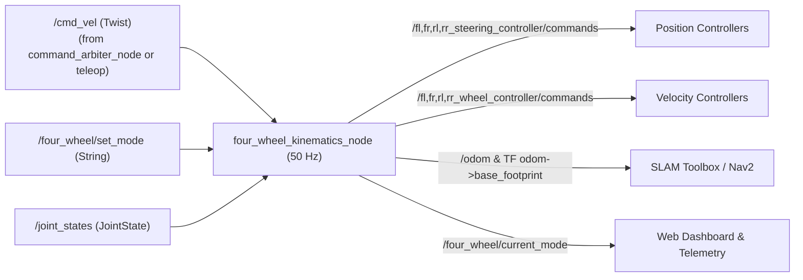

# `four_wheel_control`

Five-mode 4WS/4WD kinematic solver, closed-form least-squares planar odometry estimator, `ros2_control` configuration, and terminal keyboard teleoperation for `4ws_robot`.

---

## Overview

`four_wheel_control` converts planar vehicle velocity requests (`/cmd_vel`) into individual position targets for 4 steering knuckles and angular velocity targets for 4 drive wheels, while estimating robot planar motion (`/odom` and TF `odom -> base_footprint`) from `/joint_states`.

## Purpose

Decouples higher-level manual teleoperation and navigation planners from four-wheel kinematic geometry, enabling one robot platform to switch smoothly between Ackermann, counter-phase 4WS, crab steering, swerve, and zero-radius in-place spin.

## Features

- **Mode A (`front_steer`):** Front Ackermann curve geometry with rear knuckles locked at `0 rad`. (`TESTED`)
- **Mode B (`four_wheel_steer`):** Symmetric counter-phase front/rear steering. (`TESTED`)
- **Mode C (`crab`):** Parallel wheel steering for diagonal and lateral translation. (`TESTED`)
- **Mode D (`generalized`):** Independent corner wheel angles/speeds for full 3-DoF planar swerve. (`TESTED`)
- **Mode E (`in_place_spin`):** Tangential wheel angles (`+/-atan2(b, a)`) around chassis center for rotation in place. (`TESTED`)
- **Closed-Form Least-Squares Odometry:** Pseudo-inverse planar velocity integration using `/joint_states` header timestamps (`50 Hz`). (`TESTED`)
- **Angle Folding Optimization:** Folds wheel commands into $[-\pi/2, +\pi/2]$ with spin reversal to prevent unnecessary 180-degree knuckle flips. (`TESTED`)

## Architecture



## Directory Structure

```text
four_wheel_control/
├── package.xml
├── setup.py
├── setup.cfg
├── config/ros2_controllers.yaml
├── launch/
│   ├── control.launch.py
│   └── teleop.launch.py
└── four_wheel_control/
    ├── __init__.py
    ├── kinematics.py
    ├── four_wheel_kinematics_node.py
    └── teleop_keyboard.py
```

## Dependencies

`rclpy`, `geometry_msgs`, `nav_msgs`, `sensor_msgs`, `std_msgs`, `tf2_ros`, `python3-numpy`.

## Installation and Build

```bash
export PYTHONNOUSERSITE=1
source /opt/ros/humble/setup.bash
colcon build --packages-select four_wheel_control
source install/setup.bash
```

## Configuration

| Parameter (`four_wheel_kinematics_node` / `control.launch.py`) | Default | Description |
| :--- | :--- | :--- |
| `wheelbase` / `track_width` | `0.36` / `0.36` | Axle spacing and left-right wheel track (`m`) |
| `wheel_radius` | `0.08` | Tire rolling radius (`m`) |
| `max_steering_angle` | `1.5707963` | Mechanical knuckle angle limit (`+/-90 deg` in `rad`) |
| `max_wheel_speed` | `25.0` (`20.0` in pure `FourWheelKinematics`) | Wheel angular velocity cap (`rad/s`) |
| `default_mode` | `four_wheel_steer` | Startup steering mode identifier |
| `cmd_vel_timeout` | `0.5` | Failsafe command zeroing deadline (`s`) |
| `odom_frame` / `base_frame` | `odom` / `base_footprint` | TF frame identifiers |
| `publish_tf` | `True` | Broadcast `odom -> base_footprint` |

Controllers defined in `config/ros2_controllers.yaml` (`controller_manager` `update_rate: 50 Hz`): `joint_state_broadcaster`, `fl/fr/rl/rr_steering_controller` (`position_controllers/JointGroupPositionController`), `fl/fr/rl/rr_wheel_controller` (`velocity_controllers/JointGroupVelocityController`).

## Usage and Launch Instructions

```bash
ros2 launch four_wheel_control control.launch.py default_mode:=four_wheel_steer
```

Standalone terminal keyboard teleop (`launch/teleop.launch.py` or node):

```bash
ros2 run four_wheel_control teleop_keyboard
```

## Topics, Services, and Parameters

- **Subscribed:** `/cmd_vel` (`geometry_msgs/msg/Twist`), `/four_wheel/set_mode` (`std_msgs/msg/String`), `/joint_states` (`sensor_msgs/msg/JointState`).
- **Published:** `/fl,fr,rl,rr_steering_controller/commands` (`std_msgs/msg/Float64MultiArray`), `/fl,fr,rl,rr_wheel_controller/commands` (`std_msgs/msg/Float64MultiArray`), `/odom` (`nav_msgs/msg/Odometry`), `/four_wheel/current_mode` (`std_msgs/msg/String`), TF `odom -> base_footprint`.

## Examples

Switch steering mode cleanly via CLI:

```bash
ros2 topic pub --once /four_wheel/set_mode std_msgs/msg/String "{data: 'crab'}"
```

## Testing

- **Unit Tests (`TESTED`):** `/usr/bin/python3 -m pytest -v tests/test_kinematics.py`
- **Live Gazebo Physics Suite (run manually with live simulation):** `/usr/bin/python3 tests/test_control_simulation.py`

## Troubleshooting

- Note that non-zero lateral velocity `vy` while in `front_steer` or `four_wheel_steer` invokes crab/swerve handling internally when sent by holonomic planners (such as Nav2 DWB).
- When using `four_wheel_mobile_control`, web and Nav2 velocity commands enter through `command_arbiter_node` before reaching `/cmd_vel`. Standalone `teleop_keyboard` publishes directly to `/cmd_vel`.

## Current Limitations

- Odometry integrates purely from wheel/steering kinematics without EKF fusion against `/imu/data`, so wheel slip directly accumulates pose drift.

## Development Status

**Active / Verified (`TESTED` in unit tests & Gazebo simulation):** Core IK/FK solver and `ros2_control` bindings are operational.

## Related Packages

- Mechanical model: [`four_wheel_description`](../four_wheel_description/README.md)
- Safety multiplexer & UI: [`four_wheel_mobile_control`](../four_wheel_mobile_control/README.md)
- Nav2 / SLAM consumer: [`four_wheel_navigation`](../four_wheel_navigation/README.md)
