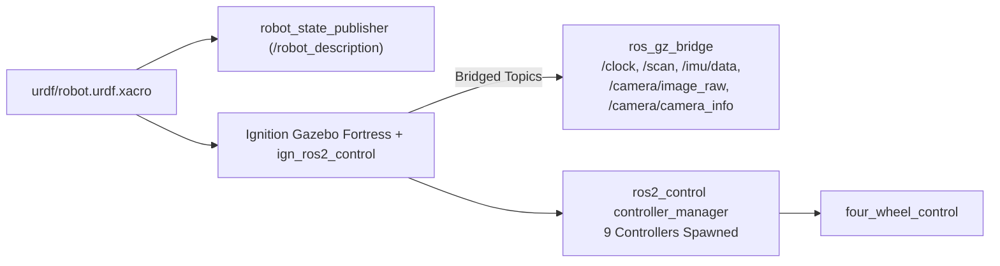

# `four_wheel_description`

URDF/Xacro mechanical description, sensor modeling, RViz2 presets, Gazebo Fortress SDF worlds, and simulation bringup for `4ws_robot`.

---

## Overview

`four_wheel_description` provides the mechanical, inertial, collision, visual, and sensor definitions of the 8-DOF Four-Wheel Steering (`4WS/4WD`) mobile robot alongside Gazebo Fortress (`6.18`) simulation launch workflows.

## Purpose

Defines the single geometric and physical model (`four_wheel_steering_robot`) consumed by `robot_state_publisher`, Ignition Gazebo Fortress, `ign_ros2_control`, RViz2, and `four_wheel_control`.

## Features

- Modular Xacro chassis (`0.50 x 0.30 x 0.10 m`, `8.0 kg`), four revolute steering knuckles, and four continuous driven traction wheels (`r = 0.08 m`, `w = 0.04 m`, `0.6 kg`). (`TESTED`)
- Gazebo Fortress `ign_ros2_control` hardware interface declarations for 4 steering position joints and 4 wheel velocity joints. (`TESTED`)
- Integrated 360-degree GPU LiDAR (`720` samples, `0.10-20.0 m`, `15 Hz`), 6-DoF IMU (`50 Hz`), and configurable RGB Camera (`640x480` default, `15 Hz`). (`TESTED`)
- Two validated Ignition Gazebo Fortress SDF worlds: `outdoor_proving_ground.sdf` and `four_wheel_arena.sdf`. (`TESTED`)
- `ros_gz_bridge` relay bridging `/clock`, `/scan`, `/imu/data`, `/camera/image_raw`, and `/camera/camera_info`. (`TESTED`)

## Architecture



## Directory Structure

```text
four_wheel_description/
├── CMakeLists.txt
├── package.xml
├── config/rviz.rviz
├── rviz/four_wheel.rviz
├── launch/
│   ├── gazebo.launch.py
│   └── complete_simulation.launch.py
├── urdf/
│   ├── robot.urdf.xacro
│   ├── chassis.xacro
│   ├── steering.xacro
│   ├── wheel.xacro
│   ├── sensors.xacro
│   ├── ros2_control.xacro
│   └── materials.xacro
└── worlds/
    ├── outdoor_proving_ground.sdf
    └── four_wheel_arena.sdf
```

## Dependencies

`ament_cmake`, `robot_state_publisher`, `joint_state_publisher`, `xacro`, `rviz2`, `ros_gz_sim`, `ros_gz_bridge`, `ign_ros2_control`.

## Installation and Build

```bash
export PYTHONNOUSERSITE=1
source /opt/ros/humble/setup.bash
colcon build --packages-select four_wheel_description
source install/setup.bash
```

## Configuration

| Xacro / Launch Argument | Default | Description |
| :--- | :--- | :--- |
| `world` | `outdoor_proving_ground.sdf` | Target Gazebo Fortress SDF world file |
| `camera_width` | `640` | RGB camera image width (px) |
| `camera_height` | `480` | RGB camera image height (px) |
| `controllers_yaml` | `four_wheel_control` YAML | `ros2_control` controller manager config path |
| `wheel_base_half` / `track_width_half` | `0.18` m / `0.18` m | Wheelbase (`0.36 m`) and track width (`0.36 m`) |

## Usage and Launch Instructions

Launch Gazebo simulation, robot spawn, controllers, and kinematics:

```bash
ros2 launch four_wheel_description gazebo.launch.py
```

Note: For the complete orchestrated stack with safety arbitration and web control, use `ros2 launch four_wheel_mobile_control complete_mobile_simulation.launch.py`.

## Topics, Frames, and Interfaces

- **Published Static/Dynamic Transforms:** `base_footprint -> base_link`, `fl/fr/rl/rr_steering_link`, `fl/fr/rl/rr_wheel_link`, `lidar_link`, `imu_link`, `camera_link`, `camera_optical_link`.
- **Bridged Gazebo Topics:** `/clock` (`rosgraph_msgs/msg/Clock`), `/scan` (`sensor_msgs/msg/LaserScan`), `/imu/data` (`sensor_msgs/msg/Imu`), `/camera/image_raw` (`sensor_msgs/msg/Image`), `/camera/camera_info` (`sensor_msgs/msg/CameraInfo`).

## Examples

Expand URDF manually to inspect joint/link trees:

```bash
xacro src/four_wheel_description/urdf/robot.urdf.xacro controllers_yaml:=/tmp/dummy.yaml > /tmp/robot.urdf
```

## Testing

- **URDF & Static Checks (`TESTED`):** `/usr/bin/python3 -m pytest -v tests/test_urdf.py tests/test_static_checks.py`

## Troubleshooting

- If `ign_ros2_control` fails to activate all 9 controllers, verify no stray `ign gazebo` process is running (`pgrep -af "ign gazebo"`) before relaunching.
- Ensure SDF worlds do not reference Gazebo Classic `libgazebo_ros_*` plugins (validated automatically by `test_static_checks.py` and `complete_mobile_simulation.launch.py`).

## Current Limitations

- Collision boxes, friction coefficients (`mu1`, `mu2`), and inertial parameters are tuned for simulated indoor/arena surfaces and require physical rover calibration before real-world deployment.
- `launch/complete_simulation.launch.py` omits `command_arbiter_node` safety multiplexing; prefer `four_wheel_mobile_control`.

## Development Status

**Stable / In Active Simulation Use (`TESTED`):** Structural Xacro and Gazebo Fortress bringup are verified.

## Related Packages

- Upstream configuration consumer: [`four_wheel_control`](../four_wheel_control/README.md)
- Orchestrated by: [`four_wheel_mobile_control`](../four_wheel_mobile_control/README.md)
