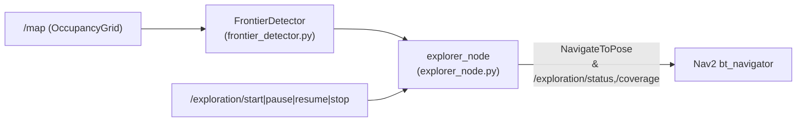

# `four_wheel_exploration`

Autonomous frontier detection, multi-criteria utility ranking, temporal goal blacklisting, and lifecycle-controlled Nav2 exploration execution for Project 04.

---

## 1. Purpose

Enables autonomous area mapping on top of `slam_toolbox` and `Nav2` by identifying unexplored occupancy boundaries on `/map`, filtering unsafe or previously unreachable targets, and dispatching validated navigation goals to `navigate_to_pose`.

---

## 2. Architecture and Components



| File | Responsibility |
| :--- | :--- |
| `four_wheel_exploration/frontier_detector.py` | 8-connected frontier extraction, Euclidean Distance Transform (EDT) obstacle clearance (`scipy.ndimage`), connected-component clustering, safe free-space projection, and cost ranking |
| `four_wheel_exploration/explorer_node.py` | ROS 2 state machine (`IDLE`, `SEARCHING`, `NAVIGATING`, `PAUSED`, `COMPLETED`), RViz frontier markers, coverage telemetry, and exploration lifecycle services |
| `config/exploration_params.yaml` | Cluster, safety clearance, distance, timeout, and blacklisting parameters |
| `launch/exploration.launch.py` | Starts `explorer_node` with simulation clock and `autostart` override support |

### ROS Services and Telemetry Topics

- **Services:** `/exploration/start`, `/exploration/pause`, `/exploration/resume`, `/exploration/stop` (`std_srvs/srv/Trigger`)
- **Published Telemetry:** `/exploration/coverage` (`std_msgs/String` JSON), `/exploration/status` (`std_msgs/String`), `/exploration/markers` (`visualization_msgs/MarkerArray`)

---

## 3. Configuration (`config/exploration_params.yaml`)

| Parameter | Default Value | Description |
| :--- | :--- | :--- |
| `min_cluster_size` | `4` | Minimum contiguous cells per valid frontier cluster |
| `obstacle_safety_distance` | `0.35` m | Minimum Euclidean obstacle clearance for safe goal projection |
| `min_distance_to_goal` / `max_distance_to_goal` | `0.40` m / `55.0` m | Candidate radial distance bounds |
| `blacklist_radius` / `blacklist_duration` | `0.60` m / `30.0` s | Spatial suppression window for failed/timed-out goals |
| `goal_timeout` | `70.0` s | Per-goal Nav2 execution deadline |
| `max_workspace_radius` | `29.0` m | Maximum exploration radius from origin |
| `exploration_rate` | `1.0` Hz | Frontier evaluation loop frequency |

---

## 4. Dependencies, Build, and Execution

**Dependencies:** `rclpy`, `nav_msgs`, `geometry_msgs`, `visualization_msgs`, `std_msgs`, `std_srvs`, `nav2_msgs`, `action_msgs`, `tf2_ros`, `python3-numpy`, `python3-scipy`.

```bash
export PYTHONNOUSERSITE=1
source /opt/ros/humble/setup.bash
colcon build --packages-select four_wheel_exploration
source install/setup.bash
```

Standalone launch (after simulation, SLAM, and Nav2 are running):

```bash
ros2 launch four_wheel_exploration exploration.launch.py autostart:=false
```

---

## 5. Safety and Stopping Behaviour

- Calling `/exploration/pause` or triggering E-Stop in `command_arbiter_node` cancels active exploration goals via Nav2 and prevents stale action completion callbacks from returning the state machine from `PAUSED`/`COMPLETED` to `SEARCHING`.
- Calling `/exploration/stop` halts exploration and transitions authority cleanly back to `MANUAL`.

---

## 6. Testing and Known Limitations

- **Unit tests (`TESTED`):** `/usr/bin/python3 -m pytest -v tests/test_exploration.py` verifies frontier detection, connected-component clustering, safe obstacle-cleared goal extraction, ranking, and blacklisting.
- **Full-map exhaustion:** Complete autonomous exhaustion of large worlds (`outdoor_proving_ground.sdf`) requires extended multi-minute runs; automated live suites validate goal dispatch, coverage expansion, and `start`/`pause`/`resume`/`stop` lifecycle transitions within bounded intervals.
