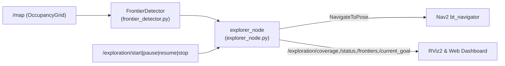

# `four_wheel_exploration`

Autonomous frontier detection, Euclidean Distance Transform obstacle-clearance filtering, multi-criteria goal ranking, and Nav2 exploration execution for `4ws_robot`.

---

## Overview

`four_wheel_exploration` inspects live SLAM occupancy grids on `/map`, locates unknown-vs-free map boundaries, selects safe reachable exploration goals, and dispatches them sequentially through Nav2 until the bounded arena is mapped or paused/stopped by an operator.

## Purpose

Automates unknown environment mapping while providing real-time coverage metrics, RViz frontier markers, blacklisting of failed targets, and safe pause/stop integration with `command_arbiter_node`.

## Features

- 8-connected frontier cell detection over `nav_msgs/OccupancyGrid`. (`TESTED`)
- Connected-component clustering (`min_cluster_size: 4`) and EDT obstacle-clearance projection (`obstacle_safety_distance: 0.35 m`) via `scipy.ndimage`. (`TESTED`)
- Multi-criteria utility cost balancing travel distance, cluster size, obstacle clearance, and sector coverage. (`TESTED`)
- Temporal spatial blacklisting (`blacklist_radius: 0.60 m`, `blacklist_duration: 30.0 s`) to skip unreachable corners. (`TESTED`)
- Safe `IDLE` / `SEARCHING` / `NAVIGATING` / `PAUSED` / `COMPLETED` state machine controlled via ROS 2 `Trigger` services. (`TESTED`)

## Architecture



## Directory Structure

```text
four_wheel_exploration/
├── package.xml
├── setup.py
├── setup.cfg
├── config/exploration_params.yaml
├── launch/exploration.launch.py
└── four_wheel_exploration/
    ├── __init__.py
    ├── frontier_detector.py
    └── explorer_node.py
```

## Dependencies

`rclpy`, `nav_msgs`, `geometry_msgs`, `visualization_msgs`, `std_msgs`, `std_srvs`, `nav2_msgs`, `action_msgs`, `tf2_ros`, `python3-numpy`, `python3-scipy`.

## Installation and Build

```bash
export PYTHONNOUSERSITE=1
source /opt/ros/humble/setup.bash
colcon build --packages-select four_wheel_exploration
source install/setup.bash
```

## Configuration (`config/exploration_params.yaml`)

| Parameter | Default | Description |
| :--- | :--- | :--- |
| `use_sim_time` | `True` | Synchronize with simulation clock |
| `min_cluster_size` | `4` | Minimum cells required for a frontier cluster |
| `obstacle_safety_distance` | `0.35` m | Minimum Euclidean clearance from occupied obstacles |
| `min_distance_to_goal` / `max_distance_to_goal` | `0.40` / `55.0` m | Acceptable candidate distance window |
| `blacklist_radius` / `blacklist_duration` | `0.60` m / `30.0` s | Suppression radius and expiry for failed targets |
| `goal_timeout` | `70.0` s | Maximum execution time per Nav2 goal |
| `max_workspace_radius` | `29.0` m | Maximum exploration radius from origin |
| `exploration_rate` | `1.0` Hz | Frontier evaluation timer frequency |

Parameter `autostart` (default `True` inside `explorer_node`, overridden to `False` in `complete_mobile_simulation.launch.py`) supports dynamic typing (`bool` / string launch args).

## Usage and Launch Instructions

```bash
ros2 launch four_wheel_exploration exploration.launch.py autostart:=false
```

Trigger exploration manually via CLI:

```bash
ros2 service call /exploration/start std_srvs/srv/Trigger "{}"
```

## Topics, Services, Actions, and Parameters

- **Subscribed:** `/map` (`nav_msgs/msg/OccupancyGrid`)
- **Published:** `/exploration/status` (`std_msgs/msg/String`), `/exploration/coverage` (`std_msgs/msg/String` JSON), `/exploration/frontiers` (`visualization_msgs/msg/MarkerArray`), `/exploration/current_goal` (`visualization_msgs/msg/Marker`)
- **Services Provided:** `/exploration/start`, `/exploration/pause`, `/exploration/resume`, `/exploration/stop` (`std_srvs/srv/Trigger`)
- **Action Client:** `navigate_to_pose` (`nav2_msgs/action/NavigateToPose`)

## Examples

Pause and stop exploration safely:

```bash
ros2 service call /exploration/pause std_srvs/srv/Trigger "{}"
ros2 service call /exploration/stop std_srvs/srv/Trigger "{}"
```

## Testing

- **Unit Tests (`TESTED`):** `/usr/bin/python3 -m pytest -v tests/test_exploration.py`
- **Lifecycle Integration (`TESTED`):** `tests/test_mobile_control_suite.py` (`test_F_autonomous_exploration_lifecycle`)

## Troubleshooting

- If `/exploration/start` schedules goals but the robot does not drive, ensure `command_arbiter_node` authority is set to `AUTONOMOUS_EXPLORE` (`ros2 topic pub --once /mobile/set_mode std_msgs/msg/String "{data: 'AUTONOMOUS_EXPLORE'}"`) or use the dashboard **START** button.

## Current Limitations

- Complete exhaustive mapping of large worlds takes several minutes of real-time simulation; automated tests bound runtime to lifecycle and initial frontier expansion verification.

## Development Status

**Active / Functional (`TESTED`):** Frontier detection unit logic and start/pause/resume/stop lifecycle operate reliably with Nav2.

## Related Packages

- Path planning & SLAM map supplier: [`four_wheel_navigation`](../four_wheel_navigation/README.md)
- Dashboard controls & E-Stop arbiter: [`four_wheel_mobile_control`](../four_wheel_mobile_control/README.md)
