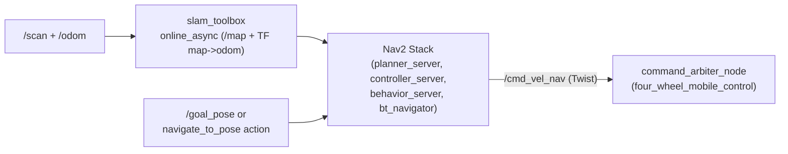

# `four_wheel_navigation`

SLAM Toolbox online asynchronous mapping, AMCL localization launch configuration, and Navigation2 (Nav2) autonomous path planning and trajectory tracking for the Project 04 `4WS/4WD` robot.

---

## 1. Purpose

Provides dynamic 2D occupancy grid mapping (`/map`), `map -> odom` transform publication, and collision-free global/local navigation tuned for a square/omni-capable four-wheel-steered footprint (`wheelbase = 0.36 m`, `track_width = 0.36 m`).

---

## 2. Architecture and Control Flow



Notice that when launched via `four_wheel_mobile_control`, `bt_navigator` / `controller_server` velocity output is routed to `/cmd_vel_nav` rather than directly to `/cmd_vel`, ensuring `command_arbiter_node` retains safety supervision and E-Stop override authority.

### Key Files

| File | Responsibility |
| :--- | :--- |
| `launch/slam.launch.py` | Starts `slam_toolbox` (`async_slam_toolbox_node`) in online async mapping mode |
| `launch/navigation.launch.py` | Starts `planner_server`, `controller_server`, `behavior_server`, `bt_navigator`, and `lifecycle_manager_navigation` |
| `launch/localization.launch.py` | Starts `map_server`, `amcl`, and localization lifecycle manager against a saved map YAML |
| `config/mapper_params_online_async.yaml` | `slam_toolbox` Ceres solver, `0.05 m` grid resolution, `20.0 m` max laser range, loop closure parameters |
| `config/nav2_params.yaml` | `DWBLocalPlanner`, `NavfnPlanner`, global and local costmap layers, `progress_checker`, and `SimpleGoalChecker` |

---

## 3. Configuration Highlights

- **SLAM Toolbox (`mapper_params_online_async.yaml`):**
  - Frames: `map_frame: map`, `odom_frame: odom`, `base_frame: base_footprint`, scan topic `/scan`.
  - Grid resolution `0.05 m`, `max_laser_range: 20.00 m`, `map_update_interval: 0.5 s`, loop closure enabled (`loop_search_maximum_distance: 8.0 m`).
- **Nav2 (`nav2_params.yaml`):**
  - Controller (`controller_server`): `20.0 Hz`, `dwb_core::DWBLocalPlanner` configured with longitudinal (`max_vel_x: 0.45 m/s`), holonomic lateral (`min_vel_y: -0.25`, `max_vel_y: 0.25 m/s`), and angular (`max_vel_theta: 1.0 rad/s`) bounds matching Mode D swerve/4WS execution.
  - Goal tolerance: `xy_goal_tolerance: 0.25 m`, `yaw_goal_tolerance: 0.30 rad`.

Saved workspace maps live in the repository root `maps/` directory (`four_wheel_arena_map.*`, `outdoor_proving_ground_map.*`, `integrated_test_map.*`).

---

## 4. Dependencies, Build, and Execution

**Dependencies:** `rclpy`, `slam_toolbox`, `nav2_bringup`, `nav2_controller`, `nav2_planner`, `nav2_behaviors`, `nav2_bt_navigator`, `nav2_lifecycle_manager`, `nav2_map_server`, `nav2_amcl`.

```bash
export PYTHONNOUSERSITE=1
source /opt/ros/humble/setup.bash
colcon build --packages-select four_wheel_navigation
source install/setup.bash
```

Run standalone modules (with simulation running):

```bash
ros2 launch four_wheel_navigation slam.launch.py
ros2 launch four_wheel_navigation navigation.launch.py cmd_vel_topic:=/cmd_vel_nav
```

For map-based AMCL localization (`IMPLEMENTED`, pass a valid map YAML):

```bash
ros2 launch four_wheel_navigation localization.launch.py map:="$(pwd)/maps/four_wheel_arena_map.yaml"
```

---

## 5. Testing and Known Limitations

- **Live SLAM + Nav2 integration (`TESTED`):** Verified during master launch and Gazebo runs (`tests/test_slam_navigation.py`, `tests/test_master_launch_e2e.py`) and live browser goal dispatch/cancel checks.
- **AMCL localization launch (`IMPLEMENTED` / `NOT VERIFIED` in standalone CI):** `localization.launch.py` is configured and parses cleanly, while most testing runs online `slam_toolbox` mapping.
- **Known limitation:** Under CPU load in headless simulation, `controller_server` (`20 Hz`) and `bt_navigator` can occasionally log missed control loop deadline warnings without failing navigation.

