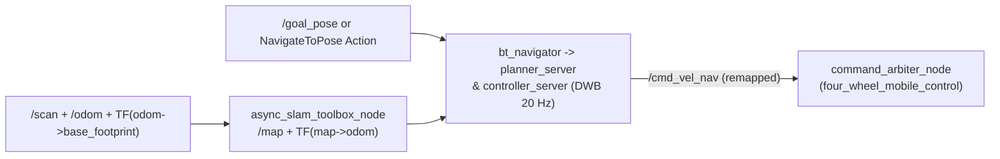

# `four_wheel_navigation`

SLAM Toolbox online asynchronous mapping, AMCL localization configuration, and Nav2 autonomous path planning and trajectory tracking for `4ws_robot`.

---

## Overview

`four_wheel_navigation` supplies the mapping (`slam_toolbox`), localization (`nav2_amcl`, `nav2_map_server`), and navigation (`NavfnPlanner`, `DWBLocalPlanner`, `bt_navigator`, `behavior_server`) configurations tuned for the holonomic-capable `0.36 x 0.36 m` `4ws_robot` platform.

## Purpose

Generates dynamic 2D occupancy maps from `/scan` and `/odom`, maintains the `map -> odom` transform, and plans collision-free global paths and local velocity trajectories toward operator or frontier-explorer goals.

## Features

- `slam_toolbox` (`online_async`) Ceres graph-based scan matching and loop closure at `0.05 m` resolution up to `20.0 m` laser range. (`TESTED`)
- Nav2 stack (`controller_server` at `20.0 Hz`, `planner_server`, `behavior_server`, `bt_navigator`, `lifecycle_manager_navigation`). (`TESTED`)
- Holonomic `DWBLocalPlanner` limits supporting both longitudinal (`0.45 m/s`) and lateral swerve/crab velocity (`+/-0.25 m/s`). (`TESTED`)
- Configurable `cmd_vel_topic` remapping (`navigation.launch.py`) so velocities route safely to `/cmd_vel_nav` -> `command_arbiter_node` rather than bypassing E-Stop control. (`TESTED`)
- Saved-map AMCL localization launch file (`localization.launch.py`). (`IMPLEMENTED` / `NOT VERIFIED` standalone)

## Architecture



## Directory Structure

```text
four_wheel_navigation/
├── package.xml
├── setup.py
├── setup.cfg
├── config/
│   ├── mapper_params_online_async.yaml
│   └── nav2_params.yaml
├── launch/
│   ├── slam.launch.py
│   ├── navigation.launch.py
│   └── localization.launch.py
└── maps/
```

## Dependencies

`rclpy`, `slam_toolbox`, `nav2_bringup`, `nav2_controller`, `nav2_planner`, `nav2_behaviors`, `nav2_bt_navigator`, `nav2_lifecycle_manager`, `nav2_map_server`, `nav2_amcl`.

## Installation and Build

```bash
export PYTHONNOUSERSITE=1
source /opt/ros/humble/setup.bash
colcon build --packages-select four_wheel_navigation
source install/setup.bash
```

## Configuration

- **`config/mapper_params_online_async.yaml`:** `odom_frame: odom`, `map_frame: map`, `base_frame: base_footprint`, `resolution: 0.05`, `min_laser_range: 0.10`, `max_laser_range: 20.00`, `map_update_interval: 0.5`, `do_loop_closing: true`.
- **`config/nav2_params.yaml`:** `controller_frequency: 20.0`, `xy_goal_tolerance: 0.25`, `yaw_goal_tolerance: 0.30`, `min_vel_x: 0.0`, `max_vel_x: 0.45`, `min_vel_y: -0.25`, `max_vel_y: 0.25`, `max_vel_theta: 1.0`.

## Usage and Launch Instructions

Run SLAM mapping:

```bash
ros2 launch four_wheel_navigation slam.launch.py
```

Run Nav2 routed to the safety arbiter (`/cmd_vel_nav`):

```bash
ros2 launch four_wheel_navigation navigation.launch.py cmd_vel_topic:=/cmd_vel_nav
```

Run AMCL localization against a saved map YAML:

```bash
ros2 launch four_wheel_navigation localization.launch.py map:="$(pwd)/maps/four_wheel_arena_map.yaml"
```

## Topics, Services, Actions, and Parameters

- **Actions:** `navigate_to_pose` (`nav2_msgs/action/NavigateToPose`) on `bt_navigator`.
- **Topics:** Subscribes `/scan`, `/odom`, `/goal_pose`; publishes `/map`, `/plan`, `/cmd_vel_nav` (when remapped via master launch).
- **Cancel Service:** `/navigate_to_pose/_action/cancel_goal` (`action_msgs/srv/CancelGoal`).

## Examples

Save the live SLAM map from the workspace root:

```bash
ros2 run nav2_map_server map_saver_cli -t /map -f maps/my_saved_map \
  --ros-args -p map_subscribe_transient_local:=true -p use_sim_time:=true
```

## Testing

- Static YAML & launch parsing: `/usr/bin/python3 -m pytest -v tests/test_static_checks.py` (`TESTED`)
- Full-stack Nav2 + SLAM integration (run against running simulation): `/usr/bin/python3 tests/test_slam_navigation.py` (`TESTED` in prior Gazebo E2E runs)

## Troubleshooting

- If Nav2 plans paths but the robot stays stationary, check `/mobile/arbiter_status`: `operating_mode` must be `AUTONOMOUS_NAV` (or `AUTONOMOUS_EXPLORE`) and `estop_active` must be `false`.
- Verify Nav2 lifecycle state reaches active: `ros2 lifecycle get /bt_navigator`.

## Current Limitations

- Under heavy simulation CPU load, `controller_server` (`20 Hz`) may log missed loop-rate warnings without blocking path completion.
- `localization.launch.py` has static launch-parse coverage only and has not been validated in the latest automated headless suite.

## Development Status

**Active / Operational (`TESTED` with `slam_toolbox` + `Nav2`):** Core online mapping and goal navigation function in live simulation.

## Related Packages

- Upstream odometry/kinematics: [`four_wheel_control`](../four_wheel_control/README.md)
- Goal producer: [`four_wheel_exploration`](../four_wheel_exploration/README.md)
- Authority arbitration & UI goal clicks: [`four_wheel_mobile_control`](../four_wheel_mobile_control/README.md)
